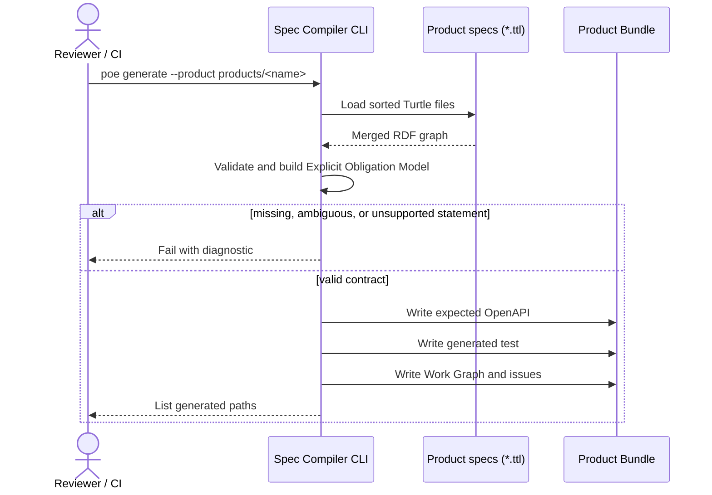
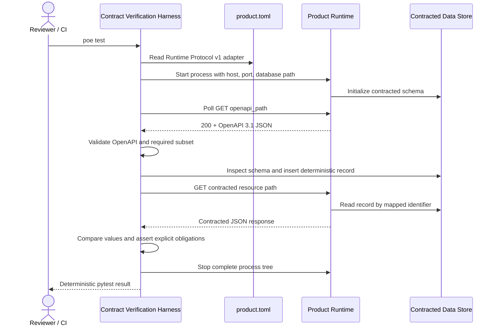
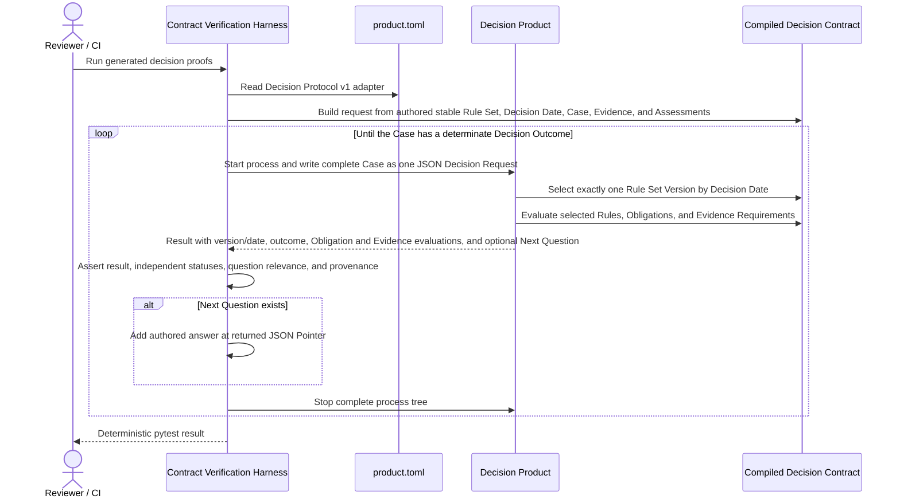
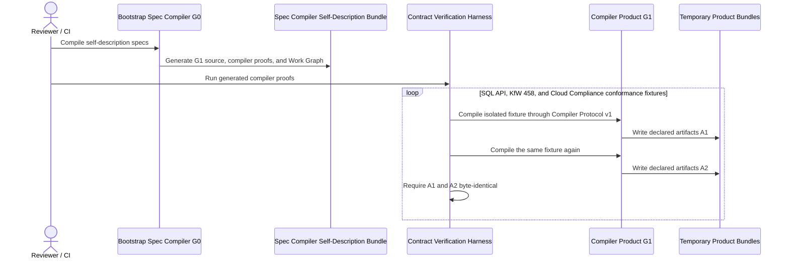
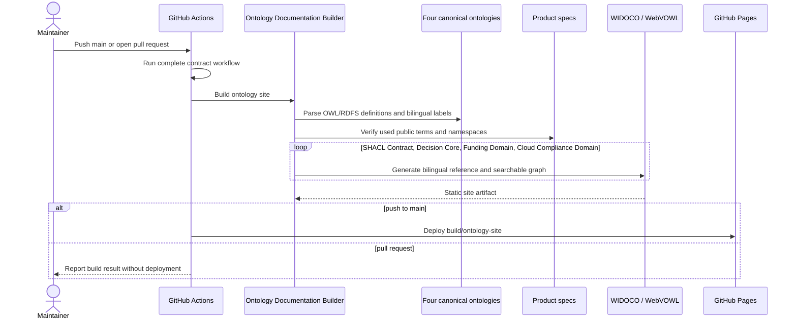
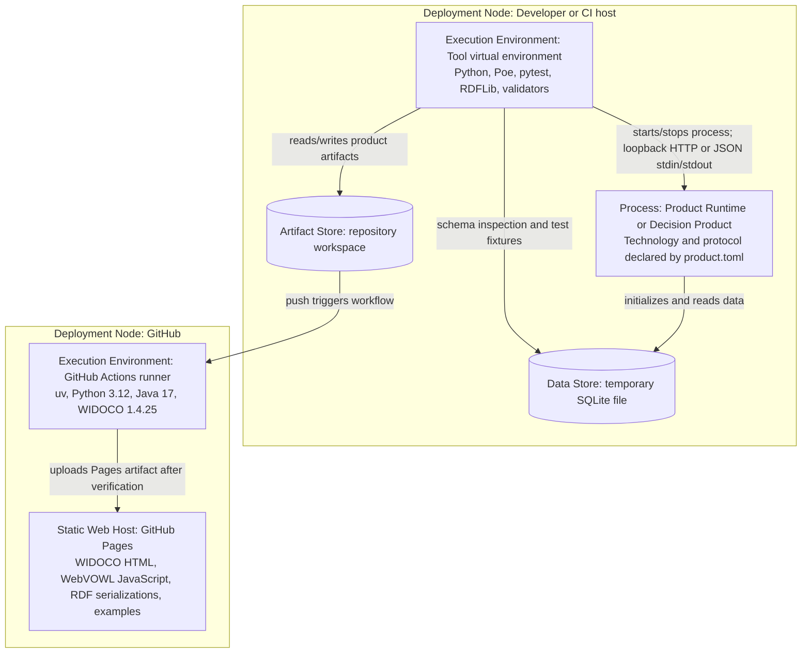

# Spec Compiler – arc42 architecture

Status: living architecture documentation for the current prototype.

This document follows the twelve-section [arc42](https://docs.arc42.org/)
structure. Static structure is modeled separately in the [C4 model](c4.md), and
normative generation rules live in the [generation principles](../generation-principles.md).

## 1. Introduction and goals

### 1.1 Requirements overview

The Spec Compiler explores whether RDF/SHACL product specifications
can be compiled deterministically into executable contracts, tests, and small
work items that guide stochastic product-code generation.

The toolchain must:

- read explicit domain, HTTP, storage, decision, rule, and provenance
  statements from Turtle specs;
- reject missing, ambiguous, or unsupported information instead of guessing;
- derive profile-specific compiled contracts, black-box tests, a Work Graph,
  and issue text from one normalized model per compiler profile;
- keep the implementation language, framework, modules, and internal product
  architecture outside the generated requirements;
- start a product through Runtime Protocol v1 and verify its externally visible
  OpenAPI, HTTP, explicit response obligations, and contracted SQLite boundaries;
- invoke compiler products through Compiler Protocol v1 and verify declared
  artifacts, failure behavior, and deterministic fixpoints as black boxes;
- invoke Decision Products through Decision Protocol v1 and verify positive,
  negative, and unknown Decision Results including Fact Gaps, explanation,
  scope, source provenance, deterministic source-justified Next Questions,
  independently evaluated Evidence Requirements and Rule-imposed Obligations,
  and the Rule Set Version selected only from an explicit Decision Date;
- keep bootstrap provenance and implementation-neutral transformation
  obligations separate;
- validate and publish the separated contract, decision-core, funding, and
  cloud-compliance vocabularies as bilingual WIDOCO references with searchable
  WebVOWL graphs;
- produce identical files for identical specs and compiler versions.

The prototype is not a complete SHACL, SQL, or OpenAPI compiler, a production
deployment system, or an autonomous coding-agent orchestrator.

ADR 0016 accepts a bounded evolution toward **Decision and Obligation
Compilation**. ADR 0017 implements its first compiler profile and source-pinned
**KfW 458 Applicant Eligibility Pilot**; ADR 0018 adds explicit Fact Questions
and Question Selection Conventions v1; ADR 0019 adds Evidence Evaluation
Conventions v1; ADR 0020 adds Version Selection Conventions v1. ADR 0021 adds
the cross-domain **Cloud Privileged-Access Compliance Slice**, a separate Cloud
Compliance Domain Ontology, and Obligation Evaluation Conventions v1. The
capability remains inside the Spec Compiler rather than becoming a second
software system.

### 1.2 Quality goals

| Priority | Goal | Architectural consequence |
| ---: | --- | --- |
| 1 | No invented requirements | Every assertion cites a spec statement or named, versioned convention; ambiguity is an error. |
| 2 | Reproducibility | Parsing order, field order, fixtures, templates, and output formatting are deterministic. |
| 3 | Product technology independence | Tests communicate with a separate Product Runtime and never import product implementation modules. |
| 4 | Traceability | Every Work Item contains obligations, sources, dependencies, exclusions, and one executable proof. |
| 5 | Portable, safe execution | The same Poe workflow runs on Windows and Linux and cleans up the complete child-process tree. |

Detailed quality scenarios are in section 10.

### 1.3 Stakeholders

| Stakeholder | Expectations |
| --- | --- |
| Spec author | Can express the supported domain, interface, storage, or decision contract without selecting a product framework. |
| Tool maintainer | Can evolve explicit compiler conventions and Runtime Protocol versions without hidden semantics. |
| Product developer or coding agent | Receives bounded, verifiable work and remains free to select implementation technology. |
| Reviewer or CI operator | Can regenerate all artifacts and verify both individual Work Items and the full product reproducibly. |
| Product consumer | Receives behavior that conforms to the compiled interface and domain contract. |
| Domain expert | Curates source-backed Rules and reviews their scope without turning an external document directly into a generated requirement. |

## 2. Architecture constraints

### 2.1 Normative constraints

- A generated requirement has exactly two permitted origins: an explicit product
  spec statement or a named, versioned convention.
- Generated tests treat the product as a black box.
- Handwritten product code, product dependencies, and `product.toml` belong to a
  Product Bundle; tool code and tool dependencies remain separate.
- Generated files are outputs and must not be edited manually.
- The repository architecture standard is defined in
  [maintenance.md](maintenance.md) and loaded for coding agents through
  `AGENTS.md`.

### 2.2 Current prototype profile

| Area | Supported profile |
| --- | --- |
| Tool implementation | Python 3.12 or newer, RDFLib, pytest, HTTPX |
| Specs | All `*.ttl` files below a Product Bundle's `specs/`, merged into one RDF graph |
| Topology | Exactly one `sco:GetEndpoint`, one `sco:SqlTable`, and one shared Shape |
| Storage | Explicitly declared SQLite with a file supplied through Runtime Protocol v1 |
| Shape values | Scalar properties with `sh:minCount` 0 or 1 and `sh:maxCount` 1 |
| Datatypes | `xsd:string`, `xsd:decimal`, and `xsd:integer` mappings; fixture synthesis currently covers Shape fields of string and decimal |
| OpenAPI profile | Self-contained OpenAPI 3.1 JSON, local `$ref`, direct schemas, no schema composition |
| Orchestration | `uv run --extra dev poe run` on a local or CI host; pytest importlib mode isolates identically named generated test modules between Product Bundles |
| Compiler product | One `schema:SoftwareApplication` conforming to `sco:CompilerProtocolV1` and linked to one `sco:TransformationContract` with declared input pattern, typed conformance fixtures and their artifact patterns, missing-spec behavior, and determinism; optional validated Bootstrap Process provenance |
| Compiler conformance | Separate SQL API, KfW 458, and Cloud Compliance fixtures declare their profile-specific expected artifacts and are compiled twice by G1 |
| Ontology publication | Four canonical OWL/RDFS vocabularies plus a separately generated SQL API example graph; WIDOCO 1.4.25, bundled WebVOWL, Java 17, static GitHub Pages artifact |
| Version control | Generated products are ignored except the versioned `sql_api_example`, `kfw_458_eligibility`, and `cloud_access_compliance` reference bundles |
| Decision compilation | One `schema:SoftwareApplication` conforming to `sco:DecisionProtocolV1`, one explicit `sdo:DecisionContract`, one stable Rule Set with source-backed non-overlapping Rule Set Versions selected by an explicit Decision Date, boolean Conditions with JSON Pointers, one explicitly worded and prioritized Fact Question per Rule Condition, zero or more explicit Rule-imposed Obligations, `requiresAllRules`, three outcomes, version-local Evidence Requirements, complete Source Citations, authored Conformance Cases covering outcomes and applicable Evidence and Obligation statuses, one complete positive Question Flow Case, and optional paired Version Selection Cases |
| Decision protocol | One UTF-8 JSON Decision Request on stdin and one JSON Decision Result on stdout; requests may carry semantic Evidence identities, types, and Assessments; results carry independent Evidence Requirement and Obligation Evaluations; repeated complete Case submissions may follow a returned Next Question; no HTTP, session, document format/storage, UI, or product-language requirement |

Python and pytest constrain the toolchain. FastAPI, Pydantic, and Uvicorn are
choices of the reference product only and do not constrain other products.

## 3. Context and scope

The authoritative System Context diagram is in [C4 level 1](c4.md#level-1-system-context).

### 3.1 Business context

The spec author records product intent. The Spec Compiler compiles it
into deterministic guidance and proofs. A product developer or optional coding
agent changes the separately bounded Generated Product. A reviewer or CI
operator runs the same toolchain to decide whether the product conforms.

The coding agent is not programmatically orchestrated by the current prototype;
the Work Graph, issue Markdown, and tests are a file-based handoff.

### 3.2 Technical context

| Neighbor | Interface into the toolchain | Interface out of the toolchain |
| --- | --- | --- |
| Spec author | Turtle files in `products/<name>/specs/` | Compiler diagnostics |
| Product developer or coding agent | Reads Work Graph, issues, expected OpenAPI, and tests | Writes implementation-owned files in the Product Bundle |
| Generated Product | `product.toml`, OpenAPI 3.1 JSON, HTTP, contracted SQLite file | Process state, HTTP responses, data-store state |
| Decision Product | Decision Protocol v1 manifest and one JSON Decision Request | JSON Decision Result with at most one Next Question, exit status, standard error, process cleanup |
| Compiler Product | Compiler Protocol v1 manifest and an input Product Bundle | Exit status, combined process output, generated files |
| Operating system | Process, loopback network, temporary files | Exit status and cleanup behavior |
| Reviewer or CI | Poe/uv commands | Generated artifacts and pytest result |
| Ontology reader | GitHub Pages URL | Four WIDOCO vocabulary references, separate WebVOWL searches, RDF downloads, and example specs |
| GitHub Pages | Static site artifact uploaded by GitHub Actions | Public HTTPS documentation |

### 3.3 System boundary

The primary software system is the **Spec Compiler** under `tools/`
plus its generated Contract Verification Harness. A **Generated Product** is a
separate software system. Its static **Product Bundle** under `products/<name>/`
is the exchange boundary between specs, generated guidance, tests, and product
implementation; the directory itself is not an executable system.

## 4. Solution strategy

| Goal | Strategy |
| --- | --- |
| No invented requirements | Validate explicit RDF relations and use only named Compiler, Runtime, or Decision conventions and protocols for remaining mappings. |
| Reproducibility | Build a normalized model for the selected profile and render all outputs with sorted inputs and fixed templates. |
| Technology independence | Start the Product Runtime from a product-owned manifest and observe it only through declared external boundaries. |
| Interface verification | Generate expected OpenAPI, validate the published document as OpenAPI 3.1, then compare the required subset within the supported profile. |
| Behavioral verification | Seed the contracted SQLite store, call the real HTTP endpoint, and assert JSON directly against explicit obligations derived from SHACL. |
| Guided implementation | Compile a dependency-ordered Work Graph whose nodes each name one executable pytest proof. |
| Tool/product separation | Keep tool and product dependencies in separate `pyproject.toml` and `uv.lock` files. |
| Compiler bootstrap | Materialize G1 deterministically from G0 at the declared implementation path, then invoke the independent G1 through its own manifest and compare repeated outputs. |
| Ontology publication | Keep four canonical vocabularies and product example graphs separate, validate public terms and bilingual labels, derive visualization-only SQL API connections, and deploy searchable WIDOCO/WebVOWL outputs. |
| Decision and obligation evolution | Compile source-backed Decisions, Obligations, and Evidence Requirements through a separate CLI protocol and typed model; preserve three-valued incompleteness, select the next explicit Fact Question only from current Fact Gaps, evaluate Evidence independently from Condition truth, and keep reusable core terms separate from Funding and Cloud Compliance Domain Ontology terms. |

See the accepted decisions in section 9 for rationale and consequences.

## 5. Building block view

The C4 [Container view](c4.md#level-2-container-view) and focused
[Component views](c4.md#level-3-component-views) are the graphical white-box
views for this section.

### 5.1 Level 1: black boxes

| Building block | Responsibility | Interfaces |
| --- | --- | --- |
| Spec Compiler | Deterministically compile specs and verify a running product. | Product Bundle files, Runtime Protocol v1, Decision Protocol v1, Compiler Protocol v1 |
| Product Bundle | Hold all authored and generated artifacts for one product. It is an artifact boundary, not a runtime process. | `specs/`, `generated/`, `tests/`, `product.toml`, implementation files |
| Generated Product | Implement the contract using technology selected by its implementer. | Product Runtime or Decision Product process and its selected protocol |
| KfW 458 Applicant Eligibility Product Bundle | Version the authored pilot Specs, Decision Protocol adapter, implementation, compiled Decision Contract, generated proofs, and Work Graph. | `products/kfw_458_eligibility/` |
| Cloud Privileged-Access Compliance Product Bundle | Version the authored cloud policy Specs, Decision Protocol adapter, implementation, compiled Decision Contract, generated proofs, and Work Graph. | `products/cloud_access_compliance/` |
| Spec Compiler Self-Description Bundle | Describe a replaceable Software Application, its Compiler Protocol conformance, and its separately versioned Transformation Contract while keeping the bootstrap trust boundary explicit. | Specs, Compiler Protocol v1 manifest, generated proofs and work |
| Ontology Documentation Site | Publish human- and machine-readable vocabulary documentation without becoming a runtime dependency of products. | GitHub Pages HTTPS, HTML, JavaScript, Turtle, JSON-LD, RDF/XML |

### 5.2 Spec Compiler CLI

| Component | Source | Responsibility |
| --- | --- | --- |
| CLI and Output Coordinator | `parse_args()`, `main()` | Validate the Product Bundle path and coordinate compilation and writes. |
| RDF/SHACL Obligation Reader | `read_obligation_model()` and parsing helpers | Merge SQL-profile Turtle files, validate them, and build the Explicit Obligation Model. |
| Decision Contract Reader | `read_decision_model()` and parsing helpers | Validate Decision Protocol conformance, Rule Set Version identities, sources and half-open validity, exactly-one date selection, decision, Rule-imposed Obligation, and version-local Evidence Requirement semantics, Fact Questions, Conformance Cases and expectations, Question Flow and Version Selection Cases, and build the typed Explicit Decision and Obligation Model. |
| Deterministic Fixture Synthesizer | `deterministic_value()` | Derive reproducible valid values from supported Shape boundaries. |
| OpenAPI Contract Renderer | `build_openapi()` | Produce `generated/expected-openapi.json`. |
| Decision Contract Renderer | `build_decision_contract()` | Produce `generated/decision-contract.json`, including authored Fact Questions, Obligations, Evidence Requirements, conformance data, convention versions, and the Question Flow Case identity, from the typed decision model. |
| Work Graph Compiler | `build_work_items()` | Produce obligations, sources, dependencies, exclusions, and proof references. |
| Issue Template Renderer | `render_issue()` | Produce natural-language Markdown without an LLM. |
| Contract Test Renderers | `TEST_TEMPLATE`, `DECISION_TEST_TEMPLATE`, `COMPILER_TEST_TEMPLATE` | Produce profile-specific black-box pytest source. |

The SQL profile's Explicit Obligation Model remains an in-memory Python
dictionary. The Decision profile's **Explicit Decision and Obligation Model**
is a frozen dataclass graph that carries its Decision Contract, Rule Set
Version, Rules, Conditions, Fact Questions, outcomes, Conformance Cases,
Question Flow Case, Obligations, Obligation Expectations, Evidence Requirements,
supplied Evidence, Evidence Assessments, Evidence Expectations, scope, and
Source Provenance. Both are shared in-memory data, not deployable building
blocks.

### 5.3 Contract Verification Harness

| Component | Source | Responsibility |
| --- | --- | --- |
| Generated Contract Test Suite | `products/<name>/tests/test_contract.py` | Define Runtime, OpenAPI, SQLite, and direct HTTP obligation proofs. |
| Product Runtime Adapter | `tools/contract_runtime.py` | Read the manifest, substitute values, start the process, detect readiness, and clean up the tree. |
| Decision Protocol Adapter | `tools/decision_runtime.py` | Read a Decision Protocol v1 manifest, exchange one UTF-8 JSON request/result pair, enforce timeout and result shape, and clean up the process tree. |
| Compiler Runtime Adapter | `tools/compiler_runtime.py` | Invoke a compiler manifest as a separate bounded process and capture its observable result. |
| Process Tree Terminator | `tools/process_runtime.py` | Provide shared Windows and POSIX child-process cleanup to runtime adapters. |
| Ontology Documentation Builder | `tools/build_ontology_site.py`, WIDOCO 1.4.25 | Validate all four vocabularies and namespace use, derive the SQL API OWL visualization projection, invoke pinned WIDOCO/WebVOWL, publish example resources, and verify the static site shape. |
| OpenAPI Verifier | Generated `_assert_openapi_*` helpers | Validate full OpenAPI 3.1 and compare the required contract subset. |
| SQLite Contract Verifier | Generated schema and fixture helpers | Inspect the schema and insert deterministic records. |
| HTTP Obligation Verifier | Generated behavior test | Call the live endpoint and directly assert required fields, types, bounds, closure, and stored values. |
| Decision Result Verifier | Generated Decision Product contract tests | Send authored Conformance Cases; assert date-selected Rule Set Versions, outcomes, independent Evidence Requirement and Obligation Evaluations, classifications, and provenance; reject missing/uncovered/caller-selected versions; and repeatedly submit Question Flow Case answers while verifying deterministic, source-justified Next Questions. |
| Runtime Regression Tests | `tools/tests/test_contract_runtime.py`, `tools/tests/test_decision_runtime.py` | Prove protocol validation and that parent and child product processes are removed after timeout or test completion. |

No component decomposition is documented for the reference Product Runtime. It
is currently one small module; inventing repository or service layers would add
an architecture that does not exist.

## 6. Runtime view

### 6.1 Generate contracts and work

### 6.2 Start and verify a product

### 6.3 Evaluate a Decision Request

The KfW and cloud reference implementations read the compiled contract at
runtime, but that is their implementation choice. Decision Protocol v1 exposes only JSON and
process behavior. A missing Fact is a Fact Gap; it is never converted to
`false`. A violated Condition takes precedence over gaps under Decision
Conventions v1, so a source-backed ineligible result can remain determinate
despite unrelated missing Facts. Question Selection Conventions v1 select the
lowest-priority Fact Question among current Fact Gaps only while the result is
`unknown`. Each invocation is stateless; the harness resubmits the accumulated
complete Case rather than relying on a product session.

Evidence Evaluation Conventions v1 evaluate every Evidence Requirement after
the Rule outcome has been derived. Applicability uses only its explicit
Conditions. An applicable requirement is `fulfilled` only by matching Evidence
with an explicit accepted Evidence Assessment; otherwise it is `missing`, and a
non-applicable requirement is `not_applicable`. The evaluation exposes its own
Source Citation and explanation. Neither Evidence nor its Assessment feeds back
into Rule Condition Evaluations or the Decision Outcome. The JSON values are
semantic identifiers and booleans, not a prescribed document representation,
upload protocol, or storage boundary.

Obligation Evaluation Conventions v1 evaluate only Obligations explicitly
imposed by a selected Rule. The Rule's Condition state becomes `fulfilled`,
`violated`, or `unknown`, and the evaluation inherits the Rule Source Citation.
This projection does not change the Decision Outcome or the independent
Evidence Requirement Evaluation. Products with no authored Obligations return
an empty list rather than inferred duties.

### 6.4 Work Item execution

1. A developer or coding agent selects a node whose dependencies are complete.
2. It reads that node's goal, obligations, sources, exclusions, and test node.
3. It changes only implementation-owned files in the Product Bundle.
4. The named pytest node decides whether the Work Item is complete.
5. The full test suite remains the final integration proof.

### 6.5 Bootstrap and verify the compiler product

`G1` is a separately materialized source artifact with its own project metadata,
lockfile, and manifest. Its implementation is deterministically derived from G0
by incrementing a generation marker and otherwise retaining the seed source.
This establishes executable bootstrap continuity and a deterministic behavioral
fixpoint, not an independent proof of compiler correctness.

### 6.6 Build and publish ontology documentation

## 7. Deployment view

Contract generation and verification run on one Windows or Linux development/CI
host. Ontology documentation additionally deploys as a static GitHub Pages
site; there is no Generated Product production deployment model yet.

- The root and reference-product environments have separate dependency manifests
  and lockfiles.
- The SQL Product Runtime binds only to the runner-supplied loopback host and
  port; the Decision Product communicates through local standard streams.
- On Windows the runner terminates the process tree with `taskkill /T /F`; on
  POSIX it uses a dedicated process group and signals the group.
- Port selection has a small bind race; the runner retries early startup failure
  up to three times.
- The Pages site is built from sources on every workflow run and is not stored
  in version control. Pull requests exercise the build without deployment.

## 8. Crosscutting concepts

### 8.1 Requirements provenance

Every generated assertion must be traceable to a spec statement or a versioned
convention. Work Items carry human-readable sources. Unsupported ambiguity is a
compiler error. The normative details are in
[generation-principles.md](../generation-principles.md).

### 8.2 Determinism

- Spec filenames and Shape fields are sorted before rendering.
- Valid fixture values follow fixed rules.
- Issue prose comes from fixed templates.
- JSON is rendered with stable insertion order and indentation.
- No LLM or external service participates in compilation.
- `COMPILER_CONVENTIONS_VERSION`, `RUNTIME_PROTOCOL_VERSION`,
  `DECISION_CONVENTIONS_VERSION`, `DECISION_PROTOCOL_VERSION`, and
  the Question Selection, Evidence Evaluation, Version Selection, and
  Obligation Evaluation convention versions expose semantic compatibility in
  generated artifacts.
- Compiler Conventions v2 derive Decision Work Item IDs from the validated
  Product Bundle directory and prune stale Markdown only inside its
  `generated/issues/` directory.
- Compiler-product Work Graphs expose `compiler_protocol_version` and validated
  Bootstrap Process provenance; generated proofs compare consecutive output
  snapshots byte for byte. Bootstrap provenance does not prescribe the product
  implementation language.
- Ontology documentation is explicitly excluded from byte-identity guarantees;
  its source vocabulary and public-term validation remain deterministic inputs.

### 8.3 Product isolation

Each product boundary consists of an explicit manifest and child process. The
selected protocol adds either OpenAPI/HTTP and named storage, or one JSON
request/result exchange over standard streams. The test language does not
constrain the product language. Tool dependencies and reference-product
dependencies are kept in separate environments.

### 8.4 Validation and error handling

The compiler rejects duplicate singleton values, unsupported datatypes or
cardinalities, unsafe identifiers and paths, inconsistent relations,
untraceable Rules, incomplete source identity, contradictory Conformance Cases,
missing or multiply assigned Fact Questions, duplicate or non-positive question
priorities, an invalid Question Flow Case, missing or contradictory Evidence
Expectations, unknown Evidence Requirements, duplicate Evidence Assessments,
invalid Evidence types, missing or contradictory Obligation Expectations,
unknown or multiply owned Obligations, missing Decision Dates, overlapping or
uncovered Rule Set Version validity, ambiguous profile selection, unknown
placeholders, and protocol-version mismatches. Runtime failures include
captured process output. OpenAPI is validated before subset comparison;
Decision Results must be JSON objects.

### 8.5 Generated artifacts

Specs and versioned conventions are inputs. Expected OpenAPI or the compiled
Decision Contract, tests, Work Graph, and issues are outputs and carry
generated-file warnings where appropriate. Changes are made at the source and
regenerated.

The WIDOCO/WebVOWL site under `build/ontology-site/` is a disposable,
unversioned documentation artifact. The canonical ontology and Product Bundle
specs remain the authored sources.

### 8.6 Security and trust

`product.toml` can execute arbitrary local commands under either product
protocol. The runners are intended only for trusted repositories and Product
Bundles. OpenAPI references are local, the
test server uses loopback networking, and test databases are temporary files.

### 8.7 Architecture documentation

arc42, C4, and ADRs use the same element names and are updated in the same change
as architecture-significant code. [maintenance.md](maintenance.md) defines the
review rules, while `AGENTS.md` loads them into Codex workflows.

### 8.8 Decision and obligation semantics

The [Decision and Obligation Compilation roadmap](decision-and-obligation-roadmap.md)
defines the current and target semantics and ontology boundaries. The first
profile implements `requiresAllRules` through Decision Conventions v1. Missing
Case Facts produce explicit Fact Gaps and may produce an `unknown` Decision
Outcome. Question Selection Conventions v1 then select at most one explicit,
source-justified Next Question from those current gaps. A client resubmits the
complete accumulated Case through the unchanged Decision Protocol v1 boundary.
Evidence Evaluation Conventions v1 independently evaluate explicitly sourced
Evidence Requirements. All applicability Conditions must be satisfied; matching
Evidence fulfills an applicable requirement only with an explicit accepted
Evidence Assessment. The resulting status, Evidence classifications,
explanation, and separate source provenance are added to the Decision Result
without changing Condition truth or the Decision Outcome.
Obligation Evaluation Conventions v1 project each explicitly Rule-imposed
Obligation from its Rule Condition: `satisfied` becomes `fulfilled`,
`violated` remains `violated`, and `unknown` remains `unknown`. Evaluations
include the Obligation text and inherited Rule provenance. Neither Obligations
nor Evidence are inferred from domain vocabulary.
Version Selection Conventions v1 then select exactly one Rule Set Version from
the stable Rule Set, explicit Decision Date, and authored half-open Validity
Periods. Version identity and validity Source Citation are compilation inputs;
the selected identity, label, and date are result fields. Requests cannot select
a version and no wall-clock/latest default exists. Missing dates, gaps, and
overlaps fail; generated Decision-product and Compiler-product black-box tests
exercise the historical boundary and ambiguity diagnostics. Ambiguous Specs,
conflicting Facts, ambiguous Rule Set Version applicability, and incompatible
entailed outcomes remain errors. External Source Revisions are reached through
Source Citations in authored Specs and do not bypass ADR 0001's permitted
requirement origins.

A Rule Set Version's version Source Citation establishes identity and validity;
Rules and Evidence Requirements may cite different immutable Source Revisions.
This permits the cloud policy Rules to cite NIST SP 800-53 while their
assessment Evidence Requirement cites NIST SP 800-53A without weakening
traceability.

## 9. Architecture decisions

| ADR | Decision | Status |
| --- | --- | --- |
| [0001](decisions/0001-requirement-provenance.md) | Specs and versioned conventions are the only sources of generated requirements. | Accepted |
| [0002](decisions/0002-black-box-product-verification.md) | Products are verified as black boxes through Runtime Protocol v1, OpenAPI, behavior, and contracted storage. | Accepted |
| [0003](decisions/0003-separate-toolchain-and-product-bundles.md) | Toolchain and Product Bundles have separate boundaries and dependencies. | Accepted |
| [0004](decisions/0004-common-contract-model-and-work-graph.md) | All deterministic outputs derive from one Contract Model; work is exposed as a dependency graph of proofs. | Accepted |
| [0005](decisions/0005-bootstrap-toolchain-self-description.md) | The toolchain is specified as a Compiler Product and verified through an explicit bootstrap trust boundary. | Accepted |
| [0006](decisions/0006-separate-product-protocol-and-transformation-contract.md) | Product identity, invocation protocol, and transformation contract vary independently; executable dispatch follows protocol conformance. | Accepted; supersedes the product-typing part of 0005 |
| [0007](decisions/0007-publish-experimental-ontology-with-github-pages.md) | The vocabulary uses separated GitHub-hosted namespaces and is published as an unversioned WIDOCO/WebVOWL GitHub Pages artifact. | Accepted |
| [0008](decisions/0008-rename-system-and-repository-to-spec-compiler.md) | The system and repository are named Spec Compiler; experimental GitHub-hosted IRIs move with the repository. | Accepted; supersedes earlier system/repository names and ADR 0007's IRI paths |
| [0009](decisions/0009-separate-bootstrap-provenance-from-transformation-contract.md) | G0 and the modify-existing strategy are explicit Bootstrap Process provenance, separate from technology-neutral product obligations. | Accepted |
| [0010](decisions/0010-materialize-and-execute-bootstrap-generation.md) | G0 deterministically materializes an independent G1 source artifact that is executed through its own project and manifest. | Accepted; supersedes ADR 0009's deferred-synthesis statement |
| [0011](decisions/0011-publish-separate-example-webvowl-graph.md) | The SQL API example receives a separate WebVOWL graph instead of being merged into the canonical vocabulary graph. | Accepted; refines ADR 0007's example-publication decision |
| [0012](decisions/0012-generate-direct-tests-from-explicit-obligations.md) | SHACL is an input profile; product JSON is checked directly from an Explicit Obligation Model without pySHACL. | Accepted |
| [0013](decisions/0013-project-example-relations-for-webvowl.md) | Explicit instance and SHACL relations are projected into visualization-only OWL edges so WebVOWL can connect the SQL API example nodes. | Accepted; refines ADR 0011 |
| [0014](decisions/0014-preserve-node-shapes-in-webvowl-projection.md) | The visualization projection preserves each Node Shape as a connected node instead of bypassing it when resolving its target class. | Accepted; refines ADR 0013 |
| [0015](decisions/0015-use-resource-namespace-as-webvowl-base.md) | The SQL API visualization uses its resource namespace as the WebVOWL ontology base so authored example nodes are classified as internal. | Accepted; refines ADR 0014 |
| [0016](decisions/0016-evolve-to-decision-and-obligation-compilation.md) | The Spec Compiler evolves through a source-backed decision and obligation capability with separate core and domain ontologies and a bounded KfW 458 applicant-eligibility pilot. | Accepted |
| [0017](decisions/0017-compile-source-backed-decisions-through-a-cli-protocol.md) | A typed decision model compiles the KfW 458 pilot into a Decision Contract and black-box proofs executed through Decision Protocol v1; decision core and funding vocabularies remain separate. | Accepted; implements and refines ADR 0016 and supersedes ADR 0003's single-reference-bundle consequence |
| [0018](decisions/0018-select-next-fact-question-from-current-fact-gaps.md) | Question Selection Conventions v1 select one explicit Fact Question from current Fact Gaps and prove stateless progression through repeated Decision Protocol v1 requests. | Accepted; extends ADR 0017 and implements Issue #3 |
| [0019](decisions/0019-evaluate-evidence-requirements-separately-from-conditions.md) | Evidence Evaluation Conventions v1 evaluate independently sourced Evidence Requirements and explicitly assessed Evidence without changing supported Conditions or Decision Outcomes. | Accepted; extends ADR 0017 and implements Issue #4 |
| [0020](decisions/0020-select-rule-set-version-only-from-validity-and-decision-date.md) | Version Selection Conventions v1 derive exactly one source-backed Rule Set Version from stable Rule Set identity, authored validity, and explicit Decision Date without today/latest defaults. | Accepted; extends ADR 0017 and implements Issue #5 |
| [0021](decisions/0021-reuse-decision-core-for-cloud-compliance-and-evaluate-obligations.md) | The cloud slice reuses the decision core without funding terms, keeps cloud vocabulary separate, permits independently sourced Rules and Evidence Requirements, and evaluates explicit Rule-imposed Obligations. | Accepted; extends ADRs 0016–0020 and implements Issue #6 |

## 10. Quality requirements

| ID | Quality | Scenario and measurable response |
| --- | --- | --- |
| Q-1 | Requirements integrity | Given a required statement is absent or ambiguous, generation stops with a diagnostic and does not substitute a framework, type, status, or architecture choice. |
| Q-2 | Reproducibility | Given unchanged specs, product path, and compiler version, two runs produce byte-identical generated files. |
| Q-3 | Technology independence | Given a product written without Python or FastAPI, it can pass when its selected Runtime or Decision Protocol and explicit specs are satisfied. |
| Q-4 | Traceability | Given any Work Item, a reviewer can identify its spec/convention sources and run exactly one named pytest node as its proof. |
| Q-5 | Fault localization | Given a wrong Runtime, OpenAPI document, SQLite schema, or HTTP response, the corresponding focused test fails. |
| Q-6 | Platform portability | On supported Windows and Linux hosts, the same Poe command generates and verifies the product without shell-specific project scripts. |
| Q-7 | Lifecycle safety | After success or failure, no Product Runtime descendant remains; a regression test verifies process-tree cleanup. |
| Q-8 | Comprehensibility | A maintainer can distinguish executable containers, static artifacts, tool choices, and product choices from arc42 and C4 without reading every source file. |
| Q-9 | Compiler bootstrap | Given the Spec Compiler Self-Description Bundle, generated black-box proofs invoke G1 twice on each declared conformance fixture and require all generated and test files to be byte-identical. |
| Q-10 | Ontology discoverability | Given a push to `main`, CI publishes four bilingual vocabulary references, RDF downloads, example resources, and separate searchable WebVOWL graphs with representative terms. |
| Q-11 | Decision explainability | Given any reference Decision Result, a reviewer can identify the selected Rule Set Version, every decisive Rule and Condition Evaluation, any Fact Gap, and the Spec statement plus Source Citation that supports it. |
| Q-12 | Question relevance and progress | Given an incomplete reference Case, the product returns the lowest-priority authored Fact Question from the current Fact Gaps with Rule and source justification; submitting authored answers repeatedly reaches a determinate result, while a determinate result returns no Next Question. |
| Q-13 | Evidence separation | Given a satisfied ownership Condition, the KfW 458 Decision Result reports the independent Evidence Requirement as `fulfilled`, `missing`, or `not_applicable`; changing an Evidence Assessment changes that status and classification but never the Condition Evaluation or Decision Outcome, and the requirement exposes its own Source Citation. |
| Q-14 | Historical reproducibility | Given identical KfW 458 applicant and project Facts dated 2026-07-20 and 2026-07-21, results select the 12/2025 and 07/2026 Rule Set Versions respectively, report the date and version, and produce the two authored source-backed outcomes; missing, uncovered, or overlapping applicability fails explicitly. |
| Q-15 | Cross-domain reuse | Given the funding and cloud Product Bundles, both compile with the same `sdo:` decision, provenance, validity, question, and evidence semantics while every applicant, funding, Cloud System, identity, and domain Outcome term remains in its Domain Ontology or Product resources. |
| Q-16 | Obligation traceability | Given any cloud Conformance Case, every selected Rule-imposed Obligation is reported as `fulfilled`, `violated`, or `unknown` with its text, Rule, Condition, and Source Citation; no Obligation is inferred for the KfW product. |

## 11. Risks and technical debt

| Risk or debt | Consequence / mitigation |
| --- | --- |
| The public ontology currently defines only the vocabulary slice exercised by the prototype. | Publication validation prevents undefined used terms, but OWL axioms and bilingual descriptions must deepen as the contract language grows. |
| Exactly one endpoint, table, parameter, and shared Shape are supported. | The model has not demonstrated multi-resource scaling. Extend only with explicit new semantics and tests. |
| The SQL profile's Explicit Obligation Model remains an untyped dictionary in a large generator module. | Renderer drift remains possible in that profile; use the typed immutable decision model as evidence for a later safe migration, not as permission for an unrelated rewrite. |
| Expected OpenAPI and tests come from the same compiler. | A shared interpretation bug can affect both oracle and proof; add independent conformance examples or mutation tests. |
| G1 is mechanically derived from G0 and judged by tests generated from the same lineage. | The bootstrap proves executable continuity and determinism but not semantic independence; retain G0 as a trust anchor and add an independent compiler or oracle before claiming diverse double compilation. |
| Experimental IRIs contain the GitHub account and repository name. | Renaming either breaks identifiers; migrate through a persistent redirect such as w3id.org before promising stable public IRIs. |
| WIDOCO/WebVOWL are documentation-build dependencies with older bundled browser assets. | Pin and hash-check WIDOCO, build the complete site in CI, self-host assets, and keep it outside product runtime boundaries. |
| GitHub Pages has no RDF content negotiation or SPARQL service. | Publish explicit HTML and serialization URLs; add dynamic infrastructure only if a demonstrated use case requires it. |
| OpenAPI comparison intentionally supports a narrow 3.1 profile. | Equivalent composed schemas may be rejected; broaden the comparator only with explicit semantics and regression tests. |
| Integer Shape fields have a mapping but no deterministic fixture synthesizer. | Such fields fail late in fixture generation; either implement the value rule or reject them earlier. |
| Generated issue cleanup removes only stale Markdown directly below a Product Bundle's `generated/issues/`. | A wider cleanup could destroy authored data; keep the target fixed and derived from the validated Product Bundle. |
| Generation writes several files non-atomically. | An interrupted run can leave mixed versions; consider staging then atomic replacement. |
| Free-port selection has a time-of-check/time-of-use race. | Three startup attempts reduce but do not eliminate rare parallel-run collisions. |
| Runtime Protocol v1 executes arbitrary commands. | Use only trusted bundles; sandboxing is outside the prototype. |
| Direct SQLite access is intentionally part of this contract profile. | It excludes opaque or remote storage implementations unless the technical contract and verifier evolve. |
| Portability is locally tested but has no visible OS CI matrix. | Add Windows and Linux CI jobs before claiming production-grade portability. |
| Unknown identifiers and other error behavior are unspecified. | Implementations may differ; add explicit specs rather than inferred `404` behavior if needed. |
| External program documents change independently of the repository. | Pin Source Revisions by identifier, declared validity, retrieval date, and content identity; never infer a latest version. |
| A scoped positive applicant result may be mistaken for funding approval or advice. | Name the Decision precisely, retain its exclusions in every presentation, and never claim legal entitlement or provider approval. |
| Two domains still provide limited evidence for a reusable ontology. | Keep Funding and Cloud Compliance Domain Ontology terms separate; require equivalent semantics in further domains plus an ADR before any promotion. |
| Decision Conventions v1 supports only boolean Conditions combined by `requiresAllRules`. | Reject disjunctions, numeric rules, and unmodeled aggregation instead of approximating them; add a new versioned convention when another project demonstrates semantics. |
| The compiler and generated tests share the same Decision Conventions implementation. | Authored eligible, ineligible, and unknown Conformance Cases catch disagreement with the Spec, but an independent oracle is still required before claiming formal correctness. |
| Question priorities are static authored policy. | The order is reproducible but not optimized for cost, information gain, audience, or branching probability; introduce richer selection semantics only through an explicit later convention. |
| The compiler, Decision Product reference implementation, and generated proof share Question Selection Conventions v1. | The authored Question Flow Case and negative-with-gap proof catch observable disagreement, but an independent implementation is still needed before claiming semantic diversity. |
| The compiler, Decision Product reference implementation, and generated proof share Evidence Evaluation Conventions v1. | Authored cases cover all three requirement statuses and a rejected-Evidence mutation, but an independent implementation is still needed before claiming semantic diversity. |
| The compiler, cloud reference implementation, and generated proof share Obligation Evaluation Conventions v1. | Authored cases cover all three statuses and explicit provenance, but the convention supports only projection from one Rule Condition; add independent implementations and richer sourced cases before modeling lifecycle or compound applicability. |
| Evidence Assessment is explicit input, not automatic document validation. | A result reports the supplied assessment semantics only; never imply document authenticity or content correctness, and add ingestion or validation only through a sourced later contract. |
| The KfW source statement is manually curated. | The compiler proves identity and traceability, not transcription completeness or legal correctness; retain human review and the scope note. |
| The NIST source statements are manually curated and the cloud slice covers only IA-2 and IA-2(1). | The compiler proves pinned identity and traceability, not assessment completeness or security; retain expert review and the explicit scope note. |
| Authored Rule Set Version intervals may contain gaps or accidental overlaps. | The compiler rejects overlaps globally and rejects any Conformance Case or runtime request whose Decision Date selects zero or multiple versions; no latest-version fallback masks catalogue defects. |

## 12. Glossary

| Term | Meaning |
| --- | --- |
| Spec Compiler | Software system that compiles product specs and verifies a separate Generated Product. |
| Generated Product | Separately executable software system whose implementation is stochastic but whose observable contract is deterministic. |
| Product Bundle | Static `products/<name>/` artifact boundary containing specs, manifest, code, generated artifacts, and tests. |
| Product Runtime | Running product process started through Runtime Protocol v1. |
| Decision Product | Running product process that implements a Decision Contract and exchanges JSON through Decision Protocol v1. |
| Product Workspace | C4 name for the file-based artifact store represented by a Product Bundle. |
| Spec | Explicit RDF/SHACL statement authored as product input. |
| Shape | SHACL description of valid resource data. |
| Contract Graph | RDF graph formed by merging the Product Bundle's sorted Turtle files. |
| Explicit Obligation Model | Normalized in-memory representation containing only explicitly sourced, externally testable obligations used by every renderer. |
| Explicit Decision and Obligation Model | Typed, immutable in-memory representation used by Decision-profile renderers; it contains version-selection, decision, interaction, obligation, evidence-evaluation, and provenance semantics. |
| Compiler Convention | Named, versioned deterministic mapping not directly expressed by a spec statement. |
| Runtime Protocol | Technology-independent contract for starting and observing a product. |
| Decision Protocol | Technology-independent process contract for exchanging one UTF-8 JSON Decision Request and Decision Result. |
| Compiler Protocol | Technology-independent contract for invoking a compiler on a Product Bundle and observing its exit status, output, and generated files. |
| Spec Compiler Self-Description Bundle | Product Bundle whose specs describe the Spec Compiler as a Compiler Product. |
| Transformation Contract | Independently identified and versionable description of accepted inputs, emitted outputs, rejection behavior, and result equivalence. |
| Canonical Ontology | One of the authored OWL/RDFS vocabulary definitions for `sco:`, `sdo:`, `funding:`, or `cloud:`; source for WIDOCO and public-term validation. |
| Ontology Documentation Site | Unversioned static WIDOCO/WebVOWL artifact deployed to GitHub Pages. |
| Bootstrap compiler (`G0`) | Trusted checked-in compiler used to generate the first executable proofs from the self-description. |
| Bootstrap Process | Provenance describing the seed implementation and evolution strategy for deriving a future implementation; not a product behavior contract. |
| Bootstrap generation (`G1`) | Independently executable compiler source materialized from G0 with its own project metadata, lockfile, and Compiler Protocol manifest. |
| Work Item | Goal, obligations, sources, dependencies, exclusions, and one executable proof. |
| Work Graph | Directed dependency graph of Work Items. |
| Expected OpenAPI | Generated OpenAPI document whose selected elements define the required HTTP contract. |
| Published OpenAPI | OpenAPI document served by the running product. |
| Contract Verification Harness | pytest process that runs generated black-box proofs with shared tool components. |
| Stochastic step | Product-code creation or modification by a human or AI agent within deterministic boundaries. |
| Decision and Obligation Compilation | Spec Compiler capability that derives source-backed Decision Contracts, Obligation and Evidence Requirement Evaluations, and proofs from explicit Specs. |
| Decision Contract | Implementation-neutral contract for one scoped decision question, candidate Rule Set Versions, outcomes, Rules, Conditions, Obligations, Evidence Requirements, provenance, and evaluation conventions. |
| Decision Request | Decision Protocol v1 JSON input naming contract, stable Rule Set, date, Case Facts, and optional supplied Evidence with Assessments; it does not select a version. |
| Decision Result | Decision Protocol v1 JSON output containing selected Rule Set Version and date, outcome, Condition and Obligation Evaluations, decisive Rules, gaps, at most one Next Question, Evidence Requirement Evaluations, provenance, explanation, and scope. |
| Rule Set | Stable identity for a governed collection of related Rules across revisions. |
| Rule Set Version | One immutable, explicitly identified revision of a Rule Set with declared applicability. |
| Rule | Normative proposition in a Spec that relates Conditions to an explicit conclusion or Obligation. |
| Fact | Explicitly supplied assertion about the Case evaluated by a Decision. |
| Fact Gap | Recorded absence of a Fact required to evaluate a Condition; it is not a false Fact. |
| Fact Question | Authored prompt tied to one Condition and input Fact, with an explicit priority. |
| Next Question | At most one Fact Question selected from current Fact Gaps while the Decision Outcome remains undetermined. |
| Question Flow Case | Complete positive Conformance Case supplying authored answers for the generated multi-step question-flow proof. |
| Version Selection Case | Conformance Case whose expected Rule Set Version is a proof oracle for selection from its explicit Decision Date. |
| Condition | Truth-valued predicate referenced by a Rule and evaluated from explicit Facts and named conventions. |
| Condition Evaluation | `satisfied`, `violated`, or `unknown` result for one Condition within one Decision. |
| Decision | Evaluation of one scoped question for one Case against exactly one applicable Rule Set Version. |
| Decision Outcome | Uniquely entailed domain conclusion, or `unknown` when Fact Gaps prevent a unique conclusion. |
| Case | Explicitly bounded subject and supplied Facts considered by one Decision. |
| Obligation | Explicitly sourced requirement that applies to a Case when its Rule applies. |
| Obligation Evaluation | `fulfilled`, `violated`, or `unknown` result for one Rule-imposed Obligation, including text, Rule, Condition, explanation, and inherited Rule provenance. |
| Evidence Requirement | Explicitly sourced requirement for information or an artifact that can support a Fact or an Obligation's fulfillment. |
| Evidence | Supplied information or artifact offered as support without becoming conclusive by mere presence. |
| Evidence Assessment | Explicit acceptance or rejection of one supplied Evidence item for one Evidence Requirement. |
| Evidence Requirement Evaluation | `fulfilled`, `missing`, or `not_applicable` result for one Evidence Requirement, including applicability states, Evidence classifications, explanation, and independent provenance. |
| Source | Stable identity for an external document or governed publication across revisions. |
| Source Revision | One immutable, identified edition of a Source whose content can be verified. |
| Source Citation | Precise locator from an authored Spec statement to a passage in one Source Revision. |
| Provenance | Navigable chain from a derived result through Rules and Specs to Source Citations or named, versioned conventions. |
| Validity Period | Half-open applicability interval whose `validFrom` is inclusive and optional `validUntil` is exclusive. |
| Decision Date | Explicit instant used to select the applicable Rule Set Version; it never defaults to runtime today. |
| Decision and Obligation Core Ontology | Public `sdo:` vocabulary defining domain-independent decision, rule, condition, case, obligation, evidence, interaction, provenance, and temporal concepts. |
| Domain Ontology | Vocabulary whose terms carry meaning specific to one problem domain. |
| Funding Domain Ontology | Public `funding:` Domain Ontology for funding programs, applicants, projects, scoped eligibility facts, and outcomes. |
| Cloud Compliance Domain Ontology | Public `cloud:` Domain Ontology for cloud systems, cloud identity Facts, scoped compliance decisions, Evidence types, and outcomes. |
| KfW 458 Applicant Eligibility Pilot | First bounded Case family, limited to natural-person applicant eligibility under the December 2025 or July 2026 source revision selected by Decision Date. |
| Cloud Privileged-Access Compliance Slice | Second bounded Case family, limited to NIST SP 800-53 Rev. 5 controls IA-2 and IA-2(1) over supplied Cloud System profile Facts. |
