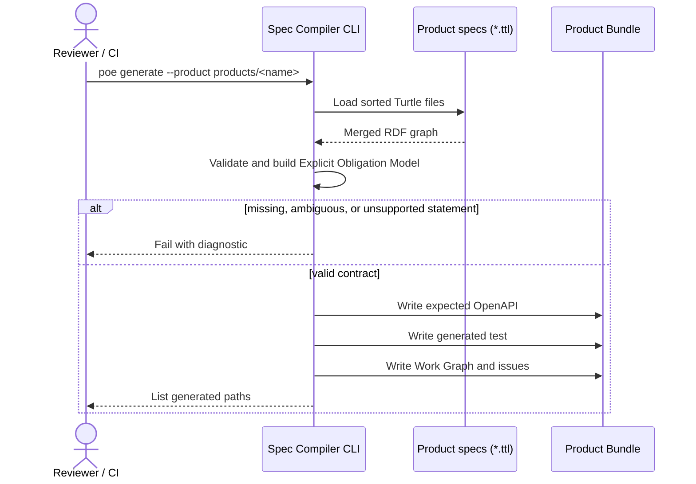
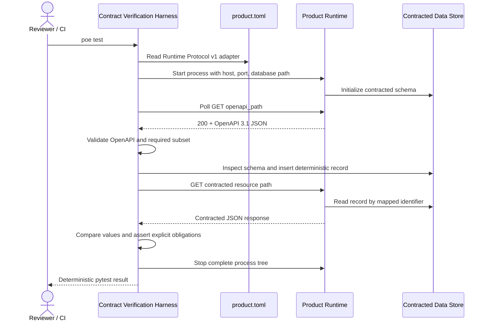
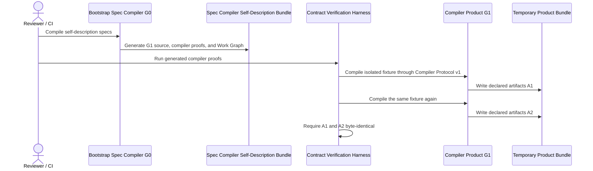
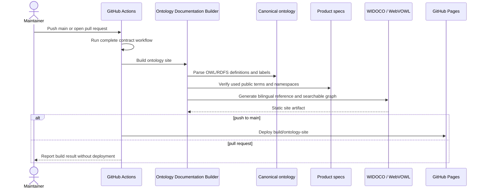
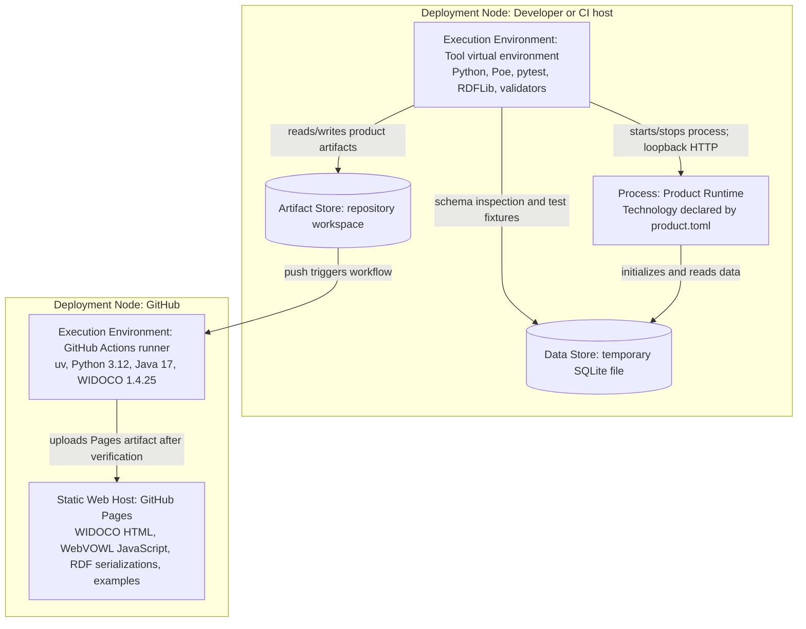

# Spec Compiler – arc42 architecture

Status: living architecture documentation for the current prototype.

This document follows the twelve-section [arc42](https://docs.arc42.org/)
structure. Static structure is modeled separately in the [C4 model](c4.md), and
normative generation rules live in the [generation principles](../generation-principles.md).

## 1. Introduction and goals

### 1.1 Requirements overview

The Spec Compiler explores whether RDF/SHACL product specifications
can be compiled deterministically into executable contracts, tests, and small
work items that guide stochastic product-code generation.

The toolchain must:

- read explicit domain, HTTP, and storage statements from Turtle specs;
- reject missing, ambiguous, or unsupported information instead of guessing;
- derive expected OpenAPI, black-box tests, a Work Graph, and issue text from one
  Explicit Obligation Model;
- keep the implementation language, framework, modules, and internal product
  architecture outside the generated requirements;
- start a product through Runtime Protocol v1 and verify its externally visible
  OpenAPI, HTTP, explicit response obligations, and contracted SQLite boundaries;
- invoke compiler products through Compiler Protocol v1 and verify declared
  artifacts, failure behavior, and deterministic fixpoints as black boxes;
- keep bootstrap provenance and implementation-neutral transformation
  obligations separate;
- validate and publish the experimental contract vocabulary as bilingual
  WIDOCO reference documentation with a searchable WebVOWL graph;
- produce identical files for identical specs and compiler versions.

The prototype is not a complete SHACL, SQL, or OpenAPI compiler, a production
deployment system, or an autonomous coding-agent orchestrator.

### 1.2 Quality goals

| Priority | Goal | Architectural consequence |
| ---: | --- | --- |
| 1 | No invented requirements | Every assertion cites a spec statement or named, versioned convention; ambiguity is an error. |
| 2 | Reproducibility | Parsing order, field order, fixtures, templates, and output formatting are deterministic. |
| 3 | Product technology independence | Tests communicate with a separate Product Runtime and never import product implementation modules. |
| 4 | Traceability | Every Work Item contains obligations, sources, dependencies, exclusions, and one executable proof. |
| 5 | Portable, safe execution | The same Poe workflow runs on Windows and Linux and cleans up the complete child-process tree. |

Detailed quality scenarios are in section 10.

### 1.3 Stakeholders

| Stakeholder | Expectations |
| --- | --- |
| Spec author | Can express the supported domain, HTTP, and storage contract without selecting a product framework. |
| Tool maintainer | Can evolve explicit compiler conventions and Runtime Protocol versions without hidden semantics. |
| Product developer or coding agent | Receives bounded, verifiable work and remains free to select implementation technology. |
| Reviewer or CI operator | Can regenerate all artifacts and verify both individual Work Items and the full product reproducibly. |
| Product consumer | Receives behavior that conforms to the published HTTP and data contract. |

## 2. Architecture constraints

### 2.1 Normative constraints

- A generated requirement has exactly two permitted origins: an explicit product
  spec statement or a named, versioned convention.
- Generated tests treat the product as a black box.
- Handwritten product code, product dependencies, and `product.toml` belong to a
  Product Bundle; tool code and tool dependencies remain separate.
- Generated files are outputs and must not be edited manually.
- The repository architecture standard is defined in
  [maintenance.md](maintenance.md) and loaded for coding agents through
  `AGENTS.md`.

### 2.2 Current prototype profile

| Area | Supported profile |
| --- | --- |
| Tool implementation | Python 3.12 or newer, RDFLib, pytest, HTTPX |
| Specs | All `*.ttl` files below a Product Bundle's `specs/`, merged into one RDF graph |
| Topology | Exactly one `sco:GetEndpoint`, one `sco:SqlTable`, and one shared Shape |
| Storage | Explicitly declared SQLite with a file supplied through Runtime Protocol v1 |
| Shape values | Scalar properties with `sh:minCount` 0 or 1 and `sh:maxCount` 1 |
| Datatypes | `xsd:string`, `xsd:decimal`, and `xsd:integer` mappings; fixture synthesis currently covers Shape fields of string and decimal |
| OpenAPI profile | Self-contained OpenAPI 3.1 JSON, local `$ref`, direct schemas, no schema composition |
| Orchestration | `uv run --extra dev poe run` on a local or CI host; pytest importlib mode isolates identically named generated test modules between Product Bundles |
| Compiler product | One `schema:SoftwareApplication` conforming to `sco:CompilerProtocolV1` and linked to one `sco:TransformationContract` with declared input pattern, fixture, artifact patterns, missing-spec behavior, and determinism; optional validated Bootstrap Process provenance |
| Ontology publication | Canonical OWL/RDFS vocabulary plus a separately generated SQL API example graph; WIDOCO 1.4.25, bundled WebVOWL, Java 17, static GitHub Pages artifact |
| Version control | Generated products are ignored except the versioned `sql_api_example` reference bundle |

Python and pytest constrain the toolchain. FastAPI, Pydantic, and Uvicorn are
choices of the reference product only and do not constrain other products.

## 3. Context and scope

The authoritative System Context diagram is in [C4 level 1](c4.md#level-1-system-context).

### 3.1 Business context

The spec author records product intent. The Spec Compiler compiles it
into deterministic guidance and proofs. A product developer or optional coding
agent changes the separately bounded Generated Product. A reviewer or CI
operator runs the same toolchain to decide whether the product conforms.

The coding agent is not programmatically orchestrated by the current prototype;
the Work Graph, issue Markdown, and tests are a file-based handoff.

### 3.2 Technical context

| Neighbor | Interface into the toolchain | Interface out of the toolchain |
| --- | --- | --- |
| Spec author | Turtle files in `products/<name>/specs/` | Compiler diagnostics |
| Product developer or coding agent | Reads Work Graph, issues, expected OpenAPI, and tests | Writes implementation-owned files in the Product Bundle |
| Generated Product | `product.toml`, OpenAPI 3.1 JSON, HTTP, contracted SQLite file | Process state, HTTP responses, data-store state |
| Compiler Product | Compiler Protocol v1 manifest and an input Product Bundle | Exit status, combined process output, generated files |
| Operating system | Process, loopback network, temporary files | Exit status and cleanup behavior |
| Reviewer or CI | Poe/uv commands | Generated artifacts and pytest result |
| Ontology reader | GitHub Pages URL | WIDOCO reference, separate vocabulary and SQL API WebVOWL searches, RDF downloads, example specs |
| GitHub Pages | Static site artifact uploaded by GitHub Actions | Public HTTPS documentation |

### 3.3 System boundary

The primary software system is the **Spec Compiler** under `tools/`
plus its generated Contract Verification Harness. A **Generated Product** is a
separate software system. Its static **Product Bundle** under `products/<name>/`
is the exchange boundary between specs, generated guidance, tests, and product
implementation; the directory itself is not an executable system.

## 4. Solution strategy

| Goal | Strategy |
| --- | --- |
| No invented requirements | Validate explicit RDF relations and use only Compiler Conventions v1 or Runtime Protocol v1 for remaining mappings. |
| Reproducibility | Build one normalized Explicit Obligation Model and render all outputs with sorted inputs and fixed templates. |
| Technology independence | Start the Product Runtime from a product-owned manifest and observe it only through declared external boundaries. |
| Interface verification | Generate expected OpenAPI, validate the published document as OpenAPI 3.1, then compare the required subset within the supported profile. |
| Behavioral verification | Seed the contracted SQLite store, call the real HTTP endpoint, and assert JSON directly against explicit obligations derived from SHACL. |
| Guided implementation | Compile a dependency-ordered Work Graph whose nodes each name one executable pytest proof. |
| Tool/product separation | Keep tool and product dependencies in separate `pyproject.toml` and `uv.lock` files. |
| Compiler bootstrap | Materialize G1 deterministically from G0 at the declared implementation path, then invoke the independent G1 through its own manifest and compare repeated outputs. |
| Ontology publication | Keep vocabulary and product example graphs separate, validate public terms and bilingual example labels, and deploy both searchable WIDOCO/WebVOWL outputs. |

See the accepted decisions in section 9 for rationale and consequences.

## 5. Building block view

The C4 [Container view](c4.md#level-2-container-view) and focused
[Component views](c4.md#level-3-component-views) are the graphical white-box
views for this section.

### 5.1 Level 1: black boxes

| Building block | Responsibility | Interfaces |
| --- | --- | --- |
| Spec Compiler | Deterministically compile specs and verify a running product. | Product Bundle files, Runtime Protocol v1, HTTP, SQLite |
| Product Bundle | Hold all authored and generated artifacts for one product. It is an artifact boundary, not a runtime process. | `specs/`, `generated/`, `tests/`, `product.toml`, implementation files |
| Generated Product | Implement the contract using technology selected by its implementer. | Product Runtime process, OpenAPI/HTTP, contracted store |
| Spec Compiler Self-Description Bundle | Describe a replaceable Software Application, its Compiler Protocol conformance, and its separately versioned Transformation Contract while keeping the bootstrap trust boundary explicit. | Specs, Compiler Protocol v1 manifest, generated proofs and work |
| Ontology Documentation Site | Publish human- and machine-readable vocabulary documentation without becoming a runtime dependency of products. | GitHub Pages HTTPS, HTML, JavaScript, Turtle, JSON-LD, RDF/XML |

### 5.2 Spec Compiler CLI

| Component | Source | Responsibility |
| --- | --- | --- |
| CLI and Output Coordinator | `parse_args()`, `main()` | Validate the Product Bundle path and coordinate compilation and writes. |
| RDF/SHACL Obligation Reader | `read_obligation_model()` and parsing helpers | Merge Turtle files, validate the supported profile, and build the Explicit Obligation Model. |
| Deterministic Fixture Synthesizer | `deterministic_value()` | Derive reproducible valid values from supported Shape boundaries. |
| OpenAPI Contract Renderer | `build_openapi()` | Produce `generated/expected-openapi.json`. |
| Work Graph Compiler | `build_work_items()` | Produce obligations, sources, dependencies, exclusions, and proof references. |
| Issue Template Renderer | `render_issue()` | Produce natural-language Markdown without an LLM. |
| Contract Test Renderer | `TEST_TEMPLATE` | Produce the black-box pytest source. |

The Explicit Obligation Model is currently an in-memory Python dictionary. It is shared
data, not an independently deployable building block.

### 5.3 Contract Verification Harness

| Component | Source | Responsibility |
| --- | --- | --- |
| Generated Contract Test Suite | `products/<name>/tests/test_contract.py` | Define Runtime, OpenAPI, SQLite, and direct HTTP obligation proofs. |
| Product Runtime Adapter | `tools/contract_runtime.py` | Read the manifest, substitute values, start the process, detect readiness, and clean up the tree. |
| Compiler Runtime Adapter | `tools/compiler_runtime.py` | Invoke a compiler manifest as a separate bounded process and capture its observable result. |
| Ontology Documentation Builder | `tools/build_ontology_site.py`, WIDOCO 1.4.25 | Validate namespace use, invoke pinned WIDOCO/WebVOWL, add landing page and example downloads, and verify the static site shape. |
| OpenAPI Verifier | Generated `_assert_openapi_*` helpers | Validate full OpenAPI 3.1 and compare the required contract subset. |
| SQLite Contract Verifier | Generated schema and fixture helpers | Inspect the schema and insert deterministic records. |
| HTTP Obligation Verifier | Generated behavior test | Call the live endpoint and directly assert required fields, types, bounds, closure, and stored values. |
| Runtime Regression Test | `tools/tests/test_contract_runtime.py` | Prove that parent and child product processes are removed after a test. |

No component decomposition is documented for the reference Product Runtime. It
is currently one small module; inventing repository or service layers would add
an architecture that does not exist.

## 6. Runtime view

### 6.1 Generate contracts and work

### 6.2 Start and verify a product

### 6.3 Work Item execution

1. A developer or coding agent selects a node whose dependencies are complete.
2. It reads that node's goal, obligations, sources, exclusions, and test node.
3. It changes only implementation-owned files in the Product Bundle.
4. The named pytest node decides whether the Work Item is complete.
5. The full test suite remains the final integration proof.

### 6.4 Bootstrap and verify the compiler product

`G1` is a separately materialized source artifact with its own project metadata,
lockfile, and manifest. Its implementation is deterministically derived from G0
by incrementing a generation marker and otherwise retaining the seed source.
This establishes executable bootstrap continuity and a deterministic behavioral
fixpoint, not an independent proof of compiler correctness.

### 6.5 Build and publish ontology documentation

## 7. Deployment view

Contract generation and verification run on one Windows or Linux development/CI
host. Ontology documentation additionally deploys as a static GitHub Pages
site; there is no Generated Product production deployment model yet.

- The root and reference-product environments have separate dependency manifests
  and lockfiles.
- The Product Runtime binds only to the runner-supplied loopback host and port in
  this test deployment.
- On Windows the runner terminates the process tree with `taskkill /T /F`; on
  POSIX it uses a dedicated process group and signals the group.
- Port selection has a small bind race; the runner retries early startup failure
  up to three times.
- The Pages site is built from sources on every workflow run and is not stored
  in version control. Pull requests exercise the build without deployment.

## 8. Crosscutting concepts

### 8.1 Requirements provenance

Every generated assertion must be traceable to a spec statement or a versioned
convention. Work Items carry human-readable sources. Unsupported ambiguity is a
compiler error. The normative details are in
[generation-principles.md](../generation-principles.md).

### 8.2 Determinism

- Spec filenames and Shape fields are sorted before rendering.
- Valid fixture values follow fixed rules.
- Issue prose comes from fixed templates.
- JSON is rendered with stable insertion order and indentation.
- No LLM or external service participates in compilation.
- `COMPILER_CONVENTIONS_VERSION` and `RUNTIME_PROTOCOL_VERSION` expose semantic
  compatibility versions in the Work Graph.
- Compiler-product Work Graphs expose `compiler_protocol_version` and validated
  Bootstrap Process provenance; generated proofs compare consecutive output
  snapshots byte for byte. Bootstrap provenance does not prescribe the product
  implementation language.
- Ontology documentation is explicitly excluded from byte-identity guarantees;
  its source vocabulary and public-term validation remain deterministic inputs.

### 8.3 Product isolation

The Product Runtime boundary consists of an explicit manifest, a child process,
OpenAPI/HTTP, and any storage named by the product contract. The test language
does not constrain the product language. Tool dependencies and sample-product
dependencies are kept in separate environments.

### 8.4 Validation and error handling

The compiler rejects duplicate singleton values, unsupported datatypes or
cardinalities, unsafe SQL identifiers, inconsistent endpoint/table relations,
unknown placeholders, and protocol-version mismatches. Runtime failures include
captured process output. OpenAPI is validated before subset comparison.

### 8.5 Generated artifacts

Specs and versioned conventions are inputs. Expected OpenAPI, tests, Work Graph,
and issues are outputs and carry generated-file warnings where appropriate.
Changes are made at the source and regenerated.

The WIDOCO/WebVOWL site under `build/ontology-site/` is a disposable,
unversioned documentation artifact. The canonical ontology and Product Bundle
specs remain the authored sources.

### 8.6 Security and trust

`product.toml` can execute arbitrary local commands under either product
protocol. The runners are intended only for trusted repositories and Product
Bundles. OpenAPI references are local, the
test server uses loopback networking, and test databases are temporary files.

### 8.7 Architecture documentation

arc42, C4, and ADRs use the same element names and are updated in the same change
as architecture-significant code. [maintenance.md](maintenance.md) defines the
review rules, while `AGENTS.md` loads them into Codex workflows.

## 9. Architecture decisions

| ADR | Decision | Status |
| --- | --- | --- |
| [0001](decisions/0001-requirement-provenance.md) | Specs and versioned conventions are the only sources of generated requirements. | Accepted |
| [0002](decisions/0002-black-box-product-verification.md) | Products are verified as black boxes through Runtime Protocol v1, OpenAPI, behavior, and contracted storage. | Accepted |
| [0003](decisions/0003-separate-toolchain-and-product-bundles.md) | Toolchain and Product Bundles have separate boundaries and dependencies. | Accepted |
| [0004](decisions/0004-common-contract-model-and-work-graph.md) | All deterministic outputs derive from one Contract Model; work is exposed as a dependency graph of proofs. | Accepted |
| [0005](decisions/0005-bootstrap-toolchain-self-description.md) | The toolchain is specified as a Compiler Product and verified through an explicit bootstrap trust boundary. | Accepted |
| [0006](decisions/0006-separate-product-protocol-and-transformation-contract.md) | Product identity, invocation protocol, and transformation contract vary independently; executable dispatch follows protocol conformance. | Accepted; supersedes the product-typing part of 0005 |
| [0007](decisions/0007-publish-experimental-ontology-with-github-pages.md) | The vocabulary uses separated GitHub-hosted namespaces and is published as an unversioned WIDOCO/WebVOWL GitHub Pages artifact. | Accepted |
| [0008](decisions/0008-rename-system-and-repository-to-spec-compiler.md) | The system and repository are named Spec Compiler; experimental GitHub-hosted IRIs move with the repository. | Accepted; supersedes earlier system/repository names and ADR 0007's IRI paths |
| [0009](decisions/0009-separate-bootstrap-provenance-from-transformation-contract.md) | G0 and the modify-existing strategy are explicit Bootstrap Process provenance, separate from technology-neutral product obligations. | Accepted |
| [0010](decisions/0010-materialize-and-execute-bootstrap-generation.md) | G0 deterministically materializes an independent G1 source artifact that is executed through its own project and manifest. | Accepted; supersedes ADR 0009's deferred-synthesis statement |
| [0011](decisions/0011-publish-separate-example-webvowl-graph.md) | The SQL API example receives a separate WebVOWL graph instead of being merged into the canonical vocabulary graph. | Accepted; refines ADR 0007's example-publication decision |
| [0012](decisions/0012-generate-direct-tests-from-explicit-obligations.md) | SHACL is an input profile; product JSON is checked directly from an Explicit Obligation Model without pySHACL. | Accepted |

## 10. Quality requirements

| ID | Quality | Scenario and measurable response |
| --- | --- | --- |
| Q-1 | Requirements integrity | Given a required statement is absent or ambiguous, generation stops with a diagnostic and does not substitute a framework, type, status, or architecture choice. |
| Q-2 | Reproducibility | Given unchanged specs, product path, and compiler version, two runs produce byte-identical generated files. |
| Q-3 | Technology independence | Given a product written without Python or FastAPI, it can pass when its manifest, HTTP/OpenAPI, and explicitly contracted store satisfy Runtime Protocol v1 and the specs. |
| Q-4 | Traceability | Given any Work Item, a reviewer can identify its spec/convention sources and run exactly one named pytest node as its proof. |
| Q-5 | Fault localization | Given a wrong Runtime, OpenAPI document, SQLite schema, or HTTP response, the corresponding focused test fails. |
| Q-6 | Platform portability | On supported Windows and Linux hosts, the same Poe command generates and verifies the product without shell-specific project scripts. |
| Q-7 | Lifecycle safety | After success or failure, no Product Runtime descendant remains; a regression test verifies process-tree cleanup. |
| Q-8 | Comprehensibility | A maintainer can distinguish executable containers, static artifacts, tool choices, and product choices from arc42 and C4 without reading every source file. |
| Q-9 | Compiler bootstrap | Given the Spec Compiler Self-Description Bundle, generated black-box proofs invoke the compiler twice on an isolated fixture and require all generated and test files to be byte-identical. |
| Q-10 | Ontology discoverability | Given a push to `main`, CI publishes bilingual term references, RDF downloads, examples, and separate vocabulary and SQL API WebVOWL graphs whose entity searches and core terms are present. |

## 11. Risks and technical debt

| Risk or debt | Consequence / mitigation |
| --- | --- |
| The public ontology currently defines only the vocabulary slice exercised by the prototype. | Publication validation prevents undefined used terms, but OWL axioms and bilingual descriptions must deepen as the contract language grows. |
| Exactly one endpoint, table, parameter, and shared Shape are supported. | The model has not demonstrated multi-resource scaling. Extend only with explicit new semantics and tests. |
| The Explicit Obligation Model is an untyped dictionary in a large generator module. | Renderer drift becomes more likely as features grow; introduce typed immutable structures before significant expansion. |
| Expected OpenAPI and tests come from the same compiler. | A shared interpretation bug can affect both oracle and proof; add independent conformance examples or mutation tests. |
| G1 is mechanically derived from G0 and judged by tests generated from the same lineage. | The bootstrap proves executable continuity and determinism but not semantic independence; retain G0 as a trust anchor and add an independent compiler or oracle before claiming diverse double compilation. |
| Experimental IRIs contain the GitHub account and repository name. | Renaming either breaks identifiers; migrate through a persistent redirect such as w3id.org before promising stable public IRIs. |
| WIDOCO/WebVOWL are documentation-build dependencies with older bundled browser assets. | Pin and hash-check WIDOCO, build the complete site in CI, self-host assets, and keep it outside product runtime boundaries. |
| GitHub Pages has no RDF content negotiation or SPARQL service. | Publish explicit HTML and serialization URLs; add dynamic infrastructure only if a demonstrated use case requires it. |
| OpenAPI comparison intentionally supports a narrow 3.1 profile. | Equivalent composed schemas may be rejected; broaden the comparator only with explicit semantics and regression tests. |
| Integer Shape fields have a mapping but no deterministic fixture synthesizer. | Such fields fail late in fixture generation; either implement the value rule or reject them earlier. |
| Obsolete generated issue files are not pruned. | Contract changes can leave stale guidance; add a manifest-driven cleanup step with safe target validation. |
| Generation writes several files non-atomically. | An interrupted run can leave mixed versions; consider staging then atomic replacement. |
| Free-port selection has a time-of-check/time-of-use race. | Three startup attempts reduce but do not eliminate rare parallel-run collisions. |
| Runtime Protocol v1 executes arbitrary commands. | Use only trusted bundles; sandboxing is outside the prototype. |
| Direct SQLite access is intentionally part of this contract profile. | It excludes opaque or remote storage implementations unless the technical contract and verifier evolve. |
| Portability is locally tested but has no visible OS CI matrix. | Add Windows and Linux CI jobs before claiming production-grade portability. |
| Unknown identifiers and other error behavior are unspecified. | Implementations may differ; add explicit specs rather than inferred `404` behavior if needed. |

## 12. Glossary

| Term | Meaning |
| --- | --- |
| Spec Compiler | Software system that compiles product specs and verifies a separate Generated Product. |
| Generated Product | Separately executable software system whose implementation is stochastic but whose observable contract is deterministic. |
| Product Bundle | Static `products/<name>/` artifact boundary containing specs, manifest, code, generated artifacts, and tests. |
| Product Runtime | Running product process started through Runtime Protocol v1. |
| Product Workspace | C4 name for the file-based artifact store represented by a Product Bundle. |
| Spec | Explicit RDF/SHACL statement authored as product input. |
| Shape | SHACL description of valid resource data. |
| Contract Graph | RDF graph formed by merging the Product Bundle's sorted Turtle files. |
| Explicit Obligation Model | Normalized in-memory representation containing only explicitly sourced, externally testable obligations used by every renderer. |
| Compiler Convention | Named, versioned deterministic mapping not directly expressed by a spec statement. |
| Runtime Protocol | Technology-independent contract for starting and observing a product. |
| Compiler Protocol | Technology-independent contract for invoking a compiler on a Product Bundle and observing its exit status, output, and generated files. |
| Spec Compiler Self-Description Bundle | Product Bundle whose specs describe the Spec Compiler as a Compiler Product. |
| Transformation Contract | Independently identified and versionable description of accepted inputs, emitted outputs, rejection behavior, and result equivalence. |
| Canonical Ontology | Authored OWL/RDFS vocabulary definition in `ontology/shacl-contract.ttl`; source for WIDOCO and public-term validation. |
| Ontology Documentation Site | Unversioned static WIDOCO/WebVOWL artifact deployed to GitHub Pages. |
| Bootstrap compiler (`G0`) | Trusted checked-in compiler used to generate the first executable proofs from the self-description. |
| Bootstrap Process | Provenance describing the seed implementation and evolution strategy for deriving a future implementation; not a product behavior contract. |
| Bootstrap generation (`G1`) | Independently executable compiler source materialized from G0 with its own project metadata, lockfile, and Compiler Protocol manifest. |
| Work Item | Goal, obligations, sources, dependencies, exclusions, and one executable proof. |
| Work Graph | Directed dependency graph of Work Items. |
| Expected OpenAPI | Generated OpenAPI document whose selected elements define the required HTTP contract. |
| Published OpenAPI | OpenAPI document served by the running product. |
| Contract Verification Harness | pytest process that runs generated black-box proofs with shared tool components. |
| Stochastic step | Product-code creation or modification by a human or AI agent within deterministic boundaries. |
