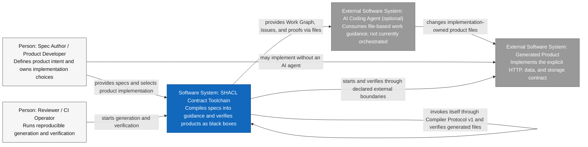
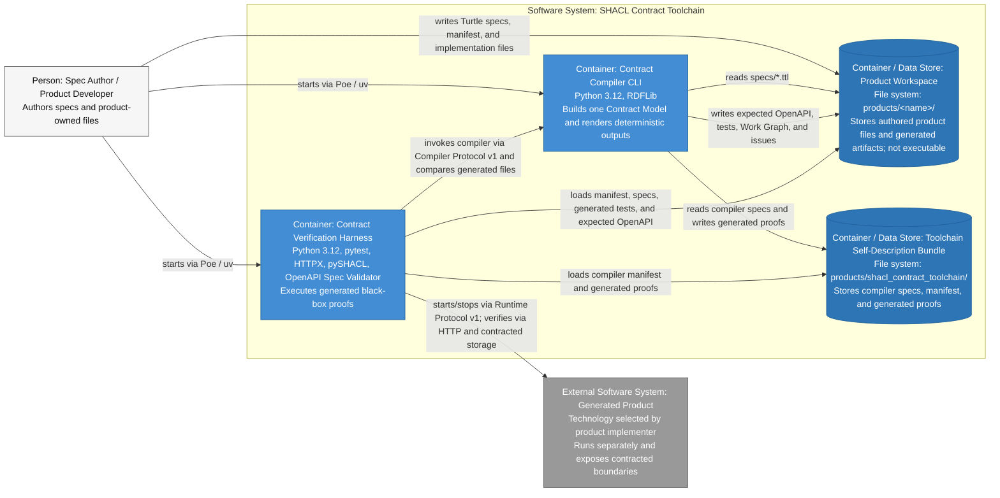
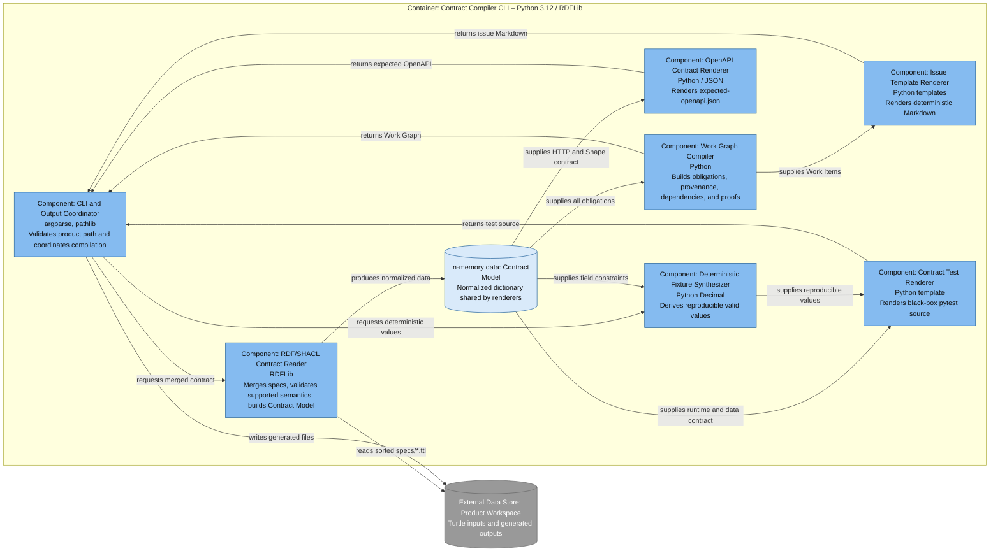
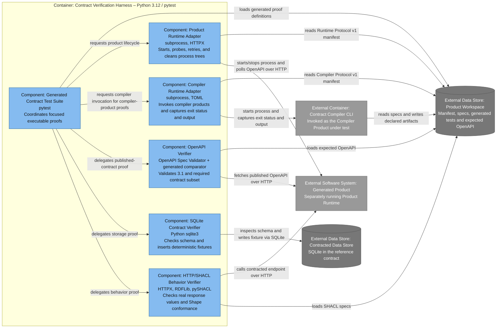

# SHACL Contract Toolchain – C4 model

This document applies the [C4 model](https://c4model.com/) to the current
prototype. It deliberately separates three concepts:

1. the executable **SHACL Contract Toolchain**,
2. the static **Product Workspace**, and
3. the separately executable **Generated Product**, and
4. the toolchain's static **Toolchain Self-Description Bundle**.

The diagrams use Mermaid because C4 is notation-independent. Every box states
its C4 element type, responsibility, and—below System Context—technology. Solid
arrows are unidirectional relationships labeled with the actual interaction.

## Level 1: System Context

Scope: the SHACL Contract Toolchain and its direct users and neighboring
software systems. Audience: everybody involved in specifying, implementing, or
reviewing products.

Legend:

| Style | C4 type |
| --- | --- |
| Blue | Software System in scope |
| Gray | External Software System |
| Light gray | Person |

The AI Coding Agent is conceptual and optional. Today the toolchain creates a
file-based handoff; it does not invoke an agent API.

Compiler products are replaceable roles, not a dedicated product class. Their
specs separate the general Software Application, its Compiler Protocol
conformance, and the Transformation Contract it implements.

## Level 2: Container view

### SHACL Contract Toolchain

Scope: executable applications and data stores inside the SHACL Contract
Toolchain. The Generated Product remains an external software system.

Legend:

| Style | C4 type |
| --- | --- |
| Medium blue box | Executable Container inside the toolchain |
| Blue cylinder | Data-store Container; file-based artifact store, not an application |
| Gray box | External Software System |
| Light gray box | Person |

Poe is command orchestration, not a Container. `tools/contract_runtime.py` and
`tools/compiler_runtime.py` are Components inside the pytest process, not
separately running Containers. The self-relationship in the System Context is
the explicit bootstrap interaction; it does not claim an independent compiler.

### SQL API Example product

Scope: runtime Containers of the Generated Product represented by
`sql_api_example`. Static specs, manifests, source files, and generated files are
not runtime Containers.

Legend:

| Style | C4 type |
| --- | --- |
| Medium blue box | Product application Container |
| Blue cylinder | Product data-store Container |
| Gray box/cylinder | Supporting element outside the product boundary |

FastAPI and Python describe only this reference Product Runtime. A different
Generated Product may use any implementation technology compatible with Runtime
Protocol v1 and its explicit product specs.

## Level 3: Component views

### Contract Compiler CLI

Scope: components executing inside the Contract Compiler CLI Container.

Legend:

| Style | C4 type |
| --- | --- |
| Light blue | Component in the Contract Compiler CLI |
| Pale blue cylinder | In-memory data, not a Component |
| Gray cylinder | External data store |

### Contract Verification Harness

Scope: components executing inside the pytest-based Contract Verification
Harness Container.

Legend:

| Style | C4 type |
| --- | --- |
| Light blue | Component in the Contract Verification Harness |
| Gray box | External Software System |
| Gray cylinder | External data store or artifact store |

## Code level

A C4 Code diagram is intentionally omitted. The compiler and runner are small,
and function-level details are already visible in source and in the Component
views. A Code diagram should be added only if a stable internal model emerges
whose relationships are not evident from the code.

## Artifact classification

This table prevents static files from drifting into C4 diagrams as fictitious
application Containers.

| Artifact | Classification | Executable C4 Container? |
| --- | --- | ---: |
| `specs/*.ttl` | Authored static input | No |
| `product.toml` | Static Runtime Protocol adapter | No |
| Compiler-product `product.toml` | Static Compiler Protocol v1 adapter | No |
| `products/shacl_contract_toolchain/` | Static Toolchain Self-Description Bundle | No |
| `app.py` or alternative product source | Source artifact | No; only the started Product Runtime is a Container |
| `tests/test_contract.py` | Generated source loaded into the pytest Container | No |
| `generated/expected-openapi.json` | Generated static contract | No |
| `generated/work-graph.json` | Generated static work description | No |
| `generated/issues/*.md` | Generated static work instructions | No |
| `/openapi.json` | Runtime HTTP resource | No |
| SQLite database file | Persistent store | Yes, as a C4 data-store Container |

## Model maintenance

The rules in [maintenance.md](maintenance.md) are normative. In particular:

- preserve the system boundary between SHACL Contract Toolchain and Generated
  Product;
- keep the canonical names used in this document;
- update relationships and technologies in the same change as code;
- do not present the optional AI Coding Agent as an automated integration until
  such orchestration exists;
- do not add conceptual product layers that are absent from the implementation.
