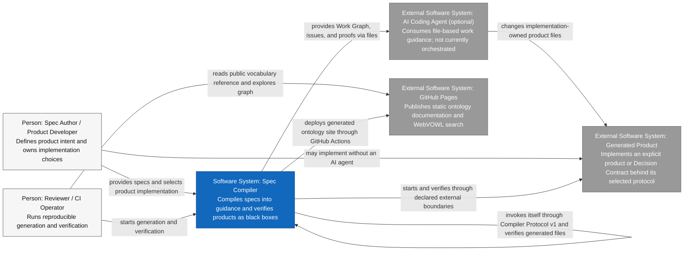
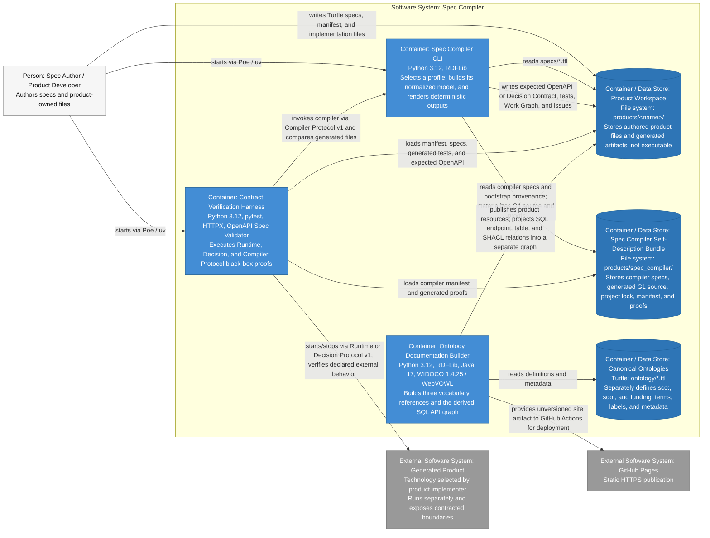
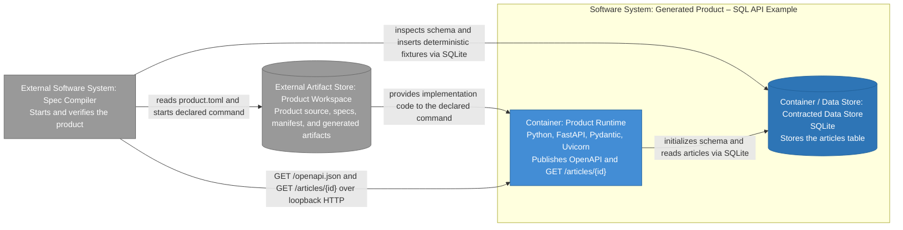
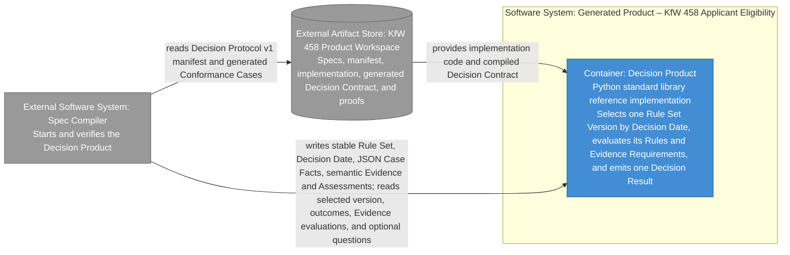
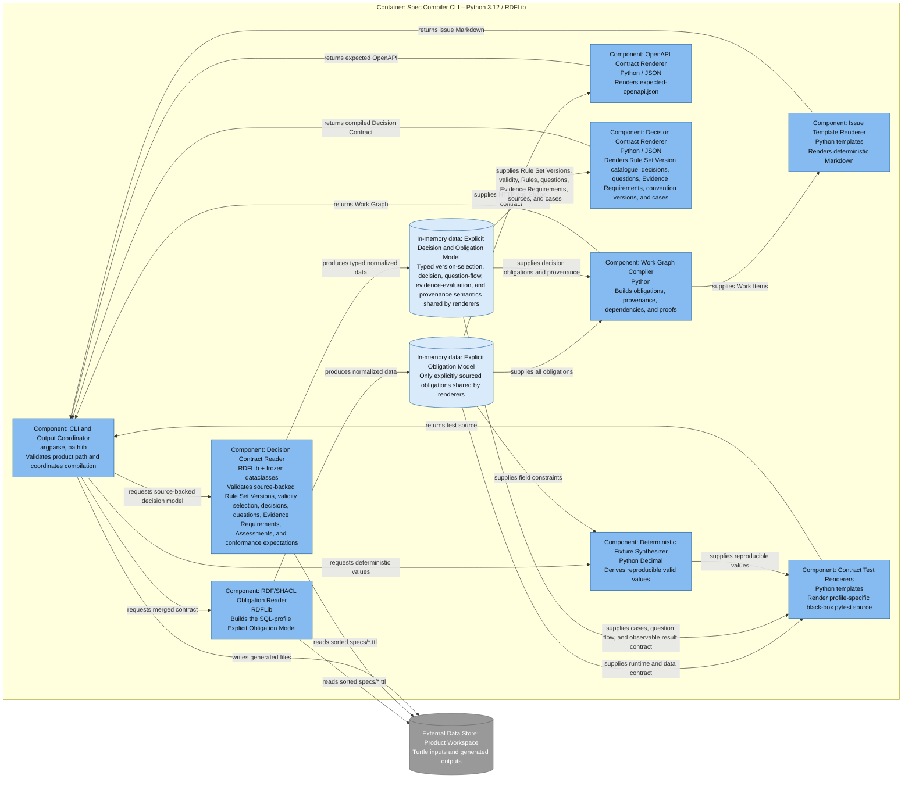
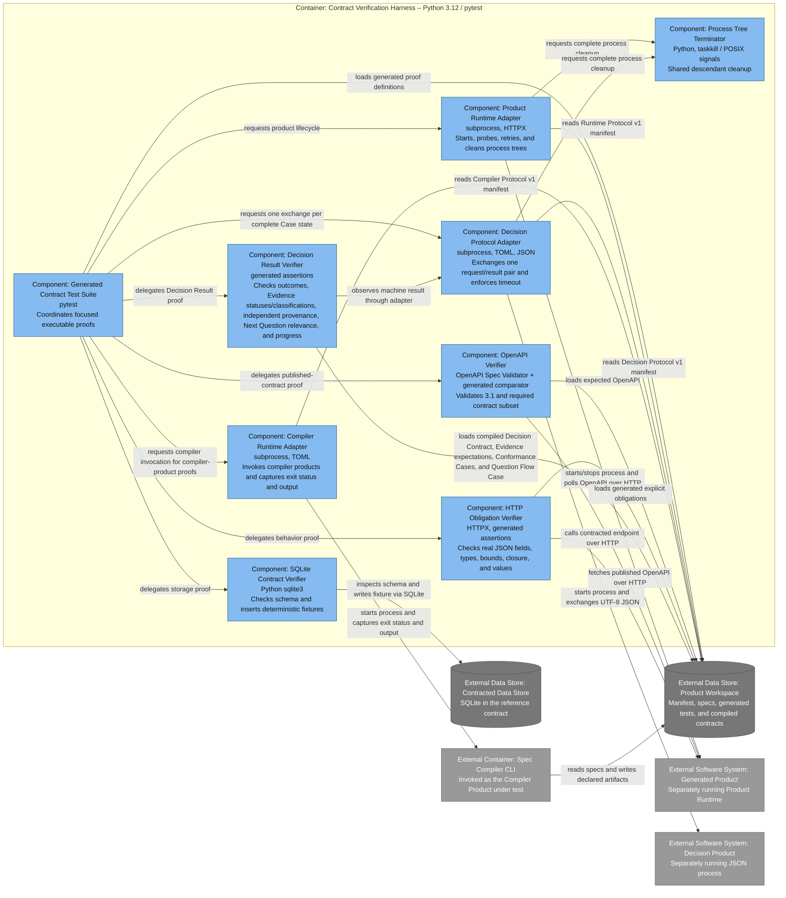

# Spec Compiler – C4 model

This document applies the [C4 model](https://c4model.com/) to the current
prototype. It deliberately separates four concepts:

1. the executable **Spec Compiler**,
2. the static **Product Workspace**, and
3. the separately executable **Generated Product**, and
4. the compiler's static **Spec Compiler Self-Description Bundle**.

The diagrams describe implemented structure, including ADR 0017's first
Decision and Obligation Compilation slice, ADR 0018's question flow, ADR
0019's evidence evaluation, and ADR 0020's historical version selection. Later roadmap concepts remain explicitly
classified without being drawn as current runtime structure.

The diagrams use Mermaid because C4 is notation-independent. Every box states
its C4 element type, responsibility, and—below System Context—technology. Solid
arrows are unidirectional relationships labeled with the actual interaction.

## Level 1: System Context

Scope: the Spec Compiler and its direct users and neighboring
software systems. Audience: everybody involved in specifying, implementing, or
reviewing products.

Legend:

| Style | C4 type |
| --- | --- |
| Blue | Software System in scope |
| Gray | External Software System |
| Light gray | Person |

The AI Coding Agent is conceptual and optional. Today the toolchain creates a
file-based handoff; it does not invoke an agent API.

Compiler products are replaceable roles, not a dedicated product class. Their
specs separate the general Software Application, its Compiler Protocol
conformance, and the Transformation Contract it implements. Optional Bootstrap
Process provenance names a seed and evolution strategy without constraining the
product contract to the seed's technology.

## Level 2: Container view

### Spec Compiler

Scope: executable applications and data stores inside the Spec Compiler
Toolchain. The Generated Product remains an external software system.

Legend:

| Style | C4 type |
| --- | --- |
| Medium blue box | Executable Container inside the toolchain |
| Blue cylinder | Data-store Container; file-based artifact store, not an application |
| Gray box | External Software System |
| Light gray box | Person |

Poe is command orchestration, not a Container. `tools/contract_runtime.py`,
`tools/decision_runtime.py`, and `tools/compiler_runtime.py` are Components
inside the pytest process, not
separately running Containers. The self-relationship in the System Context is
the explicit bootstrap interaction. G1 is independently executable from its
Product Bundle, while its source lineage remains mechanically derived from G0.

### SQL API Example product

Scope: runtime Containers of the Generated Product represented by
`sql_api_example`. Static specs, manifests, source files, and generated files are
not runtime Containers.

Legend:

| Style | C4 type |
| --- | --- |
| Medium blue box | Product application Container |
| Blue cylinder | Product data-store Container |
| Gray box/cylinder | Supporting element outside the product boundary |

FastAPI and Python describe only this reference Product Runtime. A different
Generated Product may use any implementation technology compatible with Runtime
Protocol v1 and its explicit product specs.

### KfW 458 Applicant Eligibility product

Scope: runtime Container of the Generated Product represented by
`kfw_458_eligibility`. The Product Bundle and compiled Decision Contract are
static artifact stores outside the product runtime boundary.

Legend:

| Style | C4 type |
| --- | --- |
| Medium blue box | Decision Product application Container |
| Gray box/cylinder | Supporting element outside the product boundary |

The checked-in implementation reads `generated/decision-contract.json`, but
Decision Protocol v1 does not require products to read that file or use Python.
The external KfW Source Revisions are not fetched at runtime; their immutable
identities, validity, and authored Source Citations were validated during compilation.
Repeated requests are independent Decision Protocol v1 invocations; the client
retains and resubmits accumulated Case Facts, so no session Container or UI is
introduced. Evidence values in the JSON exchange are semantic identities,
types, and Assessments; no document upload or storage Container is introduced.

## Level 3: Component views

### Spec Compiler CLI

Scope: components executing inside the Spec Compiler CLI Container.

Legend:

| Style | C4 type |
| --- | --- |
| Light blue | Component in the Spec Compiler CLI |
| Pale blue cylinder | In-memory data, not a Component |
| Gray cylinder | External data store |

### Contract Verification Harness

Scope: components executing inside the pytest-based Contract Verification
Harness Container.

Legend:

| Style | C4 type |
| --- | --- |
| Light blue | Component in the Contract Verification Harness |
| Gray box | External Software System |
| Gray cylinder | External data store or artifact store |

## Code level

A C4 Code diagram is intentionally omitted. The compiler and runner are small,
and function-level details are already visible in source and in the Component
views. A Code diagram should be added only if a stable internal model emerges
whose relationships are not evident from the code.

## Artifact classification

This table prevents static files from drifting into C4 diagrams as fictitious
application Containers.

| Artifact | Classification | Executable C4 Container? |
| --- | --- | ---: |
| `specs/*.ttl` | Authored static input | No |
| SQL-product `product.toml` | Static Runtime Protocol v1 adapter | No |
| Decision-product `product.toml` | Static Decision Protocol v1 adapter | No |
| Compiler-product `product.toml` | Static Compiler Protocol v1 adapter | No |
| `products/spec_compiler/` | Static Spec Compiler Self-Description Bundle | No |
| `ontology/shacl-contract.ttl` | Authored SHACL Contract Ontology | No |
| `ontology/decision-obligation.ttl` | Authored Decision and Obligation Core Ontology | No |
| `ontology/funding.ttl` | Authored Funding Domain Ontology | No |
| `build/ontology-site/` | Generated, unversioned static documentation artifact | No |
| `app.py` or alternative product source | Source artifact | No; only the started Product Runtime is a Container |
| `tests/test_contract.py` | Generated source loaded into the pytest Container | No |
| `generated/expected-openapi.json` | Generated static contract | No |
| `generated/decision-contract.json` | Generated static Decision Contract | No |
| `generated/work-graph.json` | Generated static work description | No |
| `generated/issues/*.md` | Generated static work instructions | No |
| `/openapi.json` | Runtime HTTP resource | No |
| SQLite database file | Persistent store | Yes, as a C4 data-store Container |

## Current and target classifications

These classifications distinguish the implemented Issues #3 and #4 slices from
later roadmap work.

| Target concept | C4 classification | Boundary consequence |
| --- | --- | --- |
| Decision and Obligation Compilation | Implemented capability of the existing Spec Compiler Software System | It is not a second Software System and does not create a new tool boundary. |
| Explicit Decision and Obligation Model | Implemented typed in-memory data inside the Spec Compiler CLI Container | It is not a Container; version-selection, decision, question-flow, evidence-evaluation, and provenance subsets are materialized. |
| Decision and Obligation Core Ontology | Implemented authored public vocabulary data store | It is published separately from the SHACL Contract Ontology. |
| Funding Domain Ontology | Implemented authored public vocabulary data store | Funding terms remain outside the decision core and compiler protocol vocabulary. |
| KfW Source Revision | External static source artifact referenced by authored Source Citations | The initial compiler does not fetch, scrape, or interpret it at runtime. |
| Decision Product | Implemented Generated Product role behind Decision Protocol v1 | JSON standard streams are contracted; HTTP, UI, language, and framework are not. |
| Fact Question and Question Flow Case | Implemented authored semantics compiled into the Decision Contract and generated proofs | They add no runtime Container; clients resubmit accumulated Case Facts through stateless protocol invocations. |
| Evidence Requirement evaluation | Implemented semantic extension of the existing capability and typed model | It adds no document store or validation service; Evidence and Assessments cross the existing Decision Protocol boundary. |
| Version Selection Conventions v1 | Implemented semantic extension of the existing capability and typed model | Stable Rule Set plus explicit Decision Date selects exactly one authored version; it adds no service or runtime source fetch. |
| Obligation activation | Planned extension of the existing capability and typed model | It must not be inferred from the name of the current model or ontology. |

The detailed target semantics and pilot scope are in the
[Decision and Obligation Compilation roadmap](decision-and-obligation-roadmap.md)
and [ADR 0016](decisions/0016-evolve-to-decision-and-obligation-compilation.md)
plus [ADR 0017](decisions/0017-compile-source-backed-decisions-through-a-cli-protocol.md),
[ADR 0018](decisions/0018-select-next-fact-question-from-current-fact-gaps.md),
[ADR 0019](decisions/0019-evaluate-evidence-requirements-separately-from-conditions.md),
and [ADR 0020](decisions/0020-select-rule-set-version-only-from-validity-and-decision-date.md).

## Model maintenance

The rules in [maintenance.md](maintenance.md) are normative. In particular:

- preserve the system boundary between Spec Compiler and Generated
  Product;
- keep the canonical names used in this document;
- update relationships and technologies in the same change as code;
- do not present the optional AI Coding Agent as an automated integration until
  such orchestration exists;
- do not add conceptual product layers that are absent from the implementation.
- keep later Decision and Obligation Compilation concepts out of implemented
  diagrams until their vertical slices change the actual structure.
